# SentinelAI CCTV — Complete Reverse-Engineering Report

**Repository:** `CCTV-COLLEGE/CCTV`
**Branch analysed:** `main` @ `71cfc07` ("scable v1") **plus 8 uncommitted working-tree modifications**
**Date of analysis:** 2026-07-28
**Analyst:** Principal Engineer onboarding review

---

## How to read this document

Every claim below is derived from files I actually opened and read. Where I could not
verify something (a file not present on disk, a runtime behaviour I could not execute,
an intent I could only infer), I say so explicitly with a **[UNVERIFIED]** or
**[INFERENCE]** marker. There are no guesses presented as facts.

Two classes of statement are distinguished throughout:

- **What the code does** — mechanical, verifiable.
- **Why it appears to do that** — inference from comments, commit messages, and structure.

---

# PHASE 1 — PROJECT OVERVIEW

## 1.1 What this project is

**SentinelAI** is a self-hosted, GPU-accelerated video surveillance platform built for a
college campus (Atria University — inferred from `seed_teachers.py` emails
`@atria.edu` and the logged-in user `subscriptions@atria.edu.in`).

It ingests video from webcams, RTSP/IP cameras, phone browsers, or uploaded video files,
and runs a multi-stage computer-vision pipeline over every frame to answer four questions:

1. **Who is in frame?** — face detection + face recognition against an enrolled gallery.
2. **When did they arrive and leave?** — temporal entry/exit state machine per person.
3. **Is anything unsafe happening?** — crowd formation, loitering, weapons, and
   person-vs-vehicle proximity.
4. **Which vehicles came through the gate?** — licence-plate recognition (ANPR) tuned
   specifically for Indian plate formats.

Unrecognised faces are not discarded. They are snapshotted, de-duplicated by embedding
similarity, and pushed into an **admin enrolment queue** so an operator can convert a
recurring stranger into a known person with two clicks.

## 1.2 What problem it solves

Conventional CCTV is a passive recording device: it answers questions only after an
incident, and only if a human watches hours of tape. This system converts a camera feed
into a **queryable event stream**:

| Traditional CCTV | SentinelAI |
|---|---|
| Records video, human reviews later | Emits structured events in real time |
| "Was someone here at 3pm?" → scrub tape | `GET /api/events?start_date=...` |
| No identity | ArcFace identity + confidence + snapshot |
| No occupancy | Live occupancy counter per camera and globally |
| Strangers invisible | Unknown-face queue with occurrence counts |
| No safety signal | Crowd / loitering / weapon / vehicle-proximity alerts |
| Manual gate log | Automatic ANPR plate capture with consensus voting |

Concretely, it produces: a live dashboard, a per-person visit history, an unknown-person
enrolment workflow, security alerting, cross-camera person tracking, and an offline
"analyse this uploaded video" mode.

## 1.3 High-level architecture

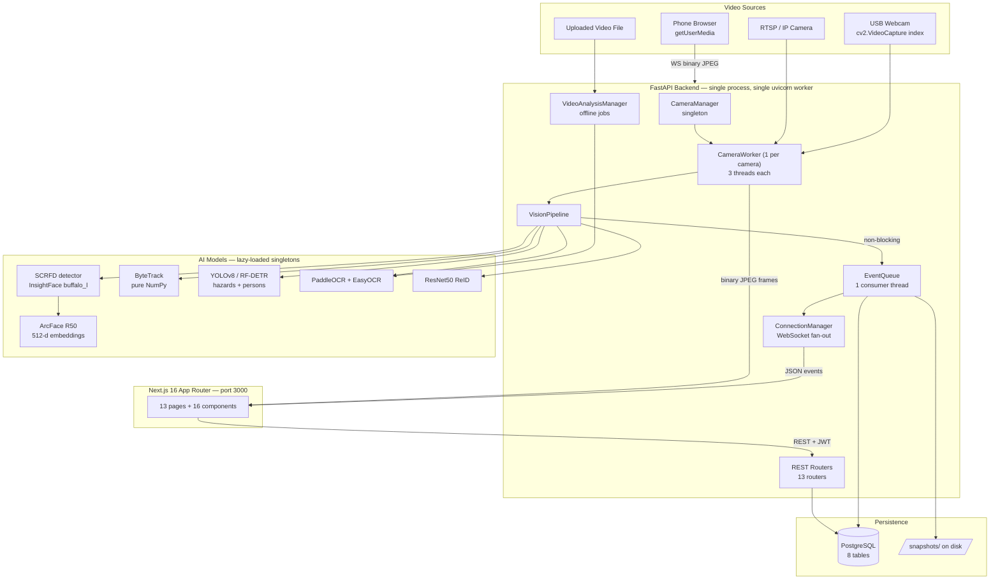

## 1.4 Major subsystems

| # | Subsystem | Entry point | Responsibility |
|---|---|---|---|
| 1 | **HTTP/WS API** | `app/main.py` | FastAPI app, 13 routers, CORS, rate limiting, static snapshots |
| 2 | **Camera management** | `app/vision/camera_worker.py` | Start/stop pipelines, own worker threads, distribute encodings |
| 3 | **Vision pipeline** | `app/vision/pipeline.py` | Per-frame orchestration — the heart of the system (1,948 lines) |
| 4 | **Face detection** | `app/vision/detector.py` | SCRFD via InsightFace; also hosts an unused `VehiclePlateDetector` |
| 5 | **Face recognition** | `app/vision/recognizer.py` | ArcFace matching, adaptive thresholds, margin check |
| 6 | **Multi-object tracking** | `app/vision/bytetrack.py` | `ByteTracker` (faces) + `VehicleByteTracker` (vehicles) |
| 7 | **Entry/exit state machine** | `app/vision/tracker.py` | `PersonTracker` — time-based presence logic |
| 8 | **Safety analytics** | `app/vision/safety_analytics.py` | Attributes, crowd clustering, loitering |
| 9 | **Hazard detection** | `app/vision/hazard_detector.py` | RF-DETR (preferred) / YOLOv8 weapon detection |
| 10 | **ANPR** | `app/vision/anpr.py` | Indian licence-plate pipeline (1,893 lines) |
| 11 | **Traffic safety** | `app/vision/traffic.py` | Roboflow/RF-DETR/YOLO vehicle+person proximity |
| 12 | **Cross-camera ReID** | `app/vision/reid.py` | ResNet50 appearance gallery |
| 13 | **Async event bus** | `app/core/event_queue.py` | Priority queue, moves all I/O off the vision thread |
| 14 | **Profiler** | `app/core/profiler.py` | Aggregate performance reports every 100 frames |
| 15 | **Persistence** | `app/db/` + `app/services/` | SQLAlchemy ORM + service layer |
| 16 | **Offline video analysis** | `app/services/video_analysis_service.py` | Batch pipeline over uploaded files |
| 17 | **Frontend** | `frontend/src/` | Next.js 16 / React 19 dashboard |

## 1.5 Data flow (steady state, FACE mode)

```mermaid
sequenceDiagram
    autonumber
    participant Cam as Camera
    participant Grab as grabber thread
    participant Loop as camera-{id} thread
    participant Pipe as VisionPipeline
    participant EQ as event-queue-consumer
    participant DB as PostgreSQL
    participant Enc as jpeg-{id} thread
    participant WSR as WS route coroutine
    participant UI as Browser

    loop tight loop, no sleep
        Grab->>Cam: capture.read()
        Grab->>Grab: _grabbed_frame = frame (overwrite)
    end

    loop throttled to 30 FPS
        Loop->>Pipe: process_frame()
        Pipe->>Grab: take + clear _grabbed_frame
        Note over Pipe: frame_count % FRAME_SKIP != 0 → redraw cached boxes, return
        Pipe->>Pipe: SCRFD detect + ArcFace embed (single pass)
        Pipe->>Pipe: ByteTracker.update()
        Pipe->>Pipe: per-track recognition-cache decision
        Pipe->>Pipe: PersonTracker.on_detection()
        Pipe-->>EQ: on_event / on_unknown (put, ~microseconds)
        Pipe-->>Loop: annotated 1080p display frame
        Loop->>Enc: single-slot handoff (latest wins)
    end

    Enc->>Enc: frame_to_jpeg_bytes() → pipeline._last_jpeg

    EQ->>DB: INSERT DetectionEvent / TrackingSession / UnknownFace
    EQ->>EQ: save_snapshot() to disk
    EQ-->>WSR: asyncio.run_coroutine_threadsafe(broadcast_event)

    WSR->>UI: JSON event over /api/events/live
    WSR->>UI: binary JPEG over /api/cameras/{id}/stream
```

**Key architectural property:** the vision thread never blocks on disk, database, or
network. Every side effect is a `queue.put_nowait()` costing microseconds. This is stated
explicitly in `event_queue.py`'s docstring: *"This eliminates 50-170ms of blocking I/O per
detection frame."*

## 1.6 Runtime thread inventory

For a deployment with **N active cameras**, the process contains:

| Thread | Count | Created by | Purpose |
|---|---|---|---|
| MainThread (asyncio loop) | 1 | uvicorn | HTTP + WebSocket coroutines |
| `grabber-{camera_id}` | N | `VisionPipeline.start()` | Drains OpenCV buffer, keeps newest frame |
| `camera-{camera_id}` | N | `CameraWorker.start()` | Detection/tracking/recognition loop |
| `jpeg-{camera_id}` | N | `CameraWorker.start()` | JPEG encoding for streaming |
| `event-queue-consumer` | 1 | `EventQueue.start()` | DB writes, snapshots, WS dispatch |
| `attr-recog-*` | 2 per pipeline | `AttributeRecognizer` | DeepFace gender analysis |
| `hazard-det-*` | 1 per pipeline | `HazardDetector` | RF-DETR/YOLO weapon inference |
| `anpr-*` | 2 per pipeline | `PlateRecognizer` | Plate detection + OCR |
| `traffic-mon-*` | 1 per pipeline | `TrafficMonitor` | Vehicle detection |
| `rf-dual-*` | 2 per pipeline | `TrafficMonitor` | Parallel Roboflow API calls |
| `video-analysis-*` | 0–2 | `VideoAnalysisManager` | Offline file processing |

At **N=1 in FACE mode** with all safety modules enabled, that is roughly **1 + 3 + 1 + 2 + 1 = 8**
application threads plus ONNX Runtime and PyTorch internal thread pools.

## 1.7 Startup sequence (summary — full trace in Phase 3)

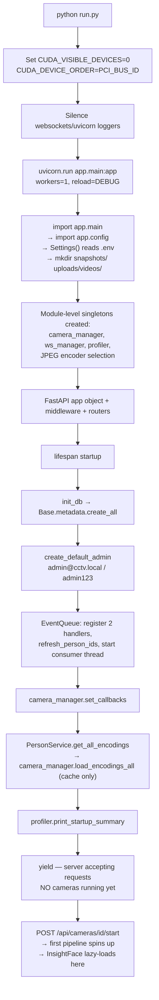

**Critical observation:** no AI model is loaded at startup. `_get_insightface_app()` is
lazy and fires on the first `FaceDetector._get_app()` call, which happens on the first
processed frame of the first camera. The first frame after a camera starts therefore takes
seconds, not milliseconds.

---

# PHASE 2 — DIRECTORY WALKTHROUGH

## 2.1 Repository tree (source only — 169 tracked files, debug artifacts elided)

```
CCTV/
├── ARCHITECTURE.md                 23 KB design doc
├── PROJECT_EXPLANATION.md          54 KB narrative doc
├── VIDEO_ANALYSIS_FEATURE.md       feature spec
├── anpr_redesign_part{1,2,3}.md    47 KB ANPR redesign notes
├── demo_strategy.md                demo script
├── implementation_plan.md          roadmap
├── project_blueprint.md            original blueprint
├── docker-compose.yml              2-service compose (backend + frontend)
├── Student/                        2 enrolment photos (JitinRaju, MukeshRao)
├── Teachers/                       25 enrolment photos, 5 per teacher
│
├── backend/
│   ├── run.py                      entry point
│   ├── requirements.txt            33 pinned/floor-pinned deps
│   ├── Dockerfile                  python:3.11-slim, CPU-only
│   ├── .env / .env.example         runtime config
│   ├── yolo11m.pt, yolov8n.pt      committed model weights
│   ├── debug_crops/, debug_crops2/ ~120 committed debug JPEGs
│   ├── debug_frame.jpg             committed debug artifact
│   ├── runs/detect/...             committed training run output
│   │
│   ├── app/
│   │   ├── main.py                 FastAPI app + event handlers   (564 L)
│   │   ├── config.py               Pydantic Settings              (225 L)
│   │   ├── database.py             compat shim re-exporting db/
│   │   ├── core/
│   │   │   ├── event_queue.py      priority async bus             (262 L)
│   │   │   ├── profiler.py         performance reports            (812 L)
│   │   │   ├── security.py         JWT + bcrypt + deps            (118 L)
│   │   │   ├── websocket.py        ConnectionManager              (99 L)
│   │   │   ├── middleware.py       pure-ASGI slow-request logger  (99 L)
│   │   │   ├── exceptions.py       5 HTTPException subclasses     (39 L)
│   │   │   └── mock_store.py       DEPRECATED, dead               (317 L)
│   │   ├── db/
│   │   │   ├── models.py           8 SQLAlchemy models            (227 L)
│   │   │   └── session.py          engine, SessionLocal, init_db  (93 L)
│   │   ├── models/                 5 Pydantic schema modules
│   │   ├── routes/                 13 routers
│   │   ├── services/               7 service classes
│   │   ├── utils/                  image_utils, time_utils
│   │   ├── vision/                 13 modules — the AI core
│   │   └── migrations/             5 raw .sql files (manual)
│   │
│   └── (15 standalone scripts: seed_*, test_*, train_*, check_*, debug_*,
│        migrate_embeddings.py, cleanup_unknowns.py, diagnose_anpr.py, demo_safety.py)
│
└── frontend/
    ├── package.json                next 16.1.6, react 19.2.3
    ├── next.config.mjs             standalone output + API rewrites
    ├── Dockerfile
    └── src/
        ├── app/                    13 App-Router pages + globals.css (2,356 L)
        ├── components/             16 React components
        └── lib/                    api.js, AuthContext, ThemeContext, ToastContext,
                                    useKeyboardShortcuts
```

## 2.2 `backend/app/vision/` — the AI core

**Purpose.** Everything that touches pixels. This is where 60 % of the backend's
complexity lives (roughly 8,600 of 14,000 backend lines).

**Responsibilities.**
- Own the per-camera processing loop and its threads.
- Load and hold AI model singletons (VRAM is a shared, scarce resource — hence singletons).
- Convert pixels → identities → events.
- Never block: all heavy secondary work is dispatched to `ThreadPoolExecutor`s.

**Important files and what they actually own.**

| File | Owns | Notes |
|---|---|---|
| `pipeline.py` | Orchestration logic | 1,948 lines. Three mode-specific frame processors: `_process_frame_*`. God object. |
| `camera_worker.py` | Thread lifecycle | `CameraWorker` (3 threads) + `CameraManager` (singleton registry) |
| `detector.py` | SCRFD wrapper + landmark geometry validation | Also contains `VehiclePlateDetector`, which **nothing imports** |
| `recognizer.py` | ArcFace gallery + matching decision | Owns serialize/deserialize of embeddings |
| `bytetrack.py` | Frame-to-frame association | Two independent trackers; identity carry-over lives here |
| `tracker.py` | Presence state machine | Pure logic, no pixels. Emits entry/exit events. |
| `search_backend.py` | Similarity search abstraction | NumPy impl; FAISS is a stub that logs a warning |
| `quality.py` | Face quality gate + pose estimation | Used by enrolment and (attempted) suggestions |
| `safety_analytics.py` | Attributes / crowd / loitering | Three independent classes, all callback-driven |
| `hazard_detector.py` | Weapon detection | RF-DETR preferred, YOLOv8 fallback |
| `anpr.py` | Licence plates | Indian-format-specific OCR correction; largest single-domain module |
| `traffic.py` | Vehicle + person proximity | Three detection backends: Roboflow API → RF-DETR → YOLO |
| `reid.py` | Cross-camera appearance matching | ResNet50, global singleton gallery |
| `benchmarks.py` | Compatibility shim | **Zero importers** — dead |

**How it interacts with other folders.**
- `vision/` → `services/` : `pipeline._auto_refresh_encodings()` calls
  `PersonService.get_all_encodings()`; `_maybe_suggest_encoding()` calls
  `EmbeddingSuggestionService`.
- `vision/` → `routes/` : **layering violation.** `pipeline.process_frame()` does
  `from app.routes.browser_camera import _browser_sessions`. The AI layer reaches into
  the HTTP layer's module-global state.
- `vision/` → `core/` : profiler instrumentation everywhere.
- `main.py` → `vision/` : sets callbacks, owns the camera_manager singleton reference.

## 2.3 `backend/app/core/` — cross-cutting infrastructure

**Purpose.** Framework-adjacent concerns that are not business logic and not AI.

- **`event_queue.py`** is the most architecturally significant file here. It defines a
  two-priority `queue.Queue` wrapper. `CRITICAL` events (entry, exit, security_alert)
  are never dropped — if the queue is full they retry with a 1 s timeout and, as a last
  resort, execute **synchronously on the caller's thread**. `NORMAL` events (unknown
  faces, suggestions) are silently dropped when full, with a warning every 50th drop.
  It also holds an in-memory `Set[str]` of known person IDs used as a foreign-key guard
  (see Phase 8 for the staleness bug this creates).
- **`profiler.py`** is a 812-line instrumentation system. It aggregates per-stage timings
  and prints a formatted report every 100 frames covering FPS, SCRFD sub-stage breakdown,
  AI vs non-AI split, recognition-cache hit rate with reason breakdown, identity carry-over
  success rate, event-queue health, snapshot/DB/WebSocket stats, GPU utilisation (pynvml
  with a torch fallback) and CPU usage (psutil).
- **`security.py`** — bcrypt hashing (72-byte truncation handled), `python-jose` JWT
  encode/decode, and two FastAPI dependencies: `get_current_user` and `require_admin`.
- **`websocket.py`** — `ConnectionManager` singleton with two connection registries:
  a flat list for event subscribers and a `Dict[camera_id, List[WebSocket]]` for streams.
  Note: `send_frame`/`connect_stream` exist but the camera stream route does **not** use
  them; it polls `pipeline._last_jpeg` directly.
- **`middleware.py`** — deliberately implemented as raw ASGI rather than
  `BaseHTTPMiddleware`, with a comment citing
  `github.com/encode/starlette/issues/1600` (BaseHTTPMiddleware wraps responses in
  `StreamingResponse` and strips headers set by outer middleware, breaking CORS). Logs
  only requests ≥ 400 or > 100 ms, and injects an `X-Request-ID` header.
- **`mock_store.py`** — its own docstring says *"DEPRECATED — no active code imports this
  module."* I verified: nothing does.

## 2.4 `backend/app/db/` and `backend/app/models/`

Two different things share a confusingly similar name:

- **`app/db/models.py`** — SQLAlchemy **ORM** models (the actual tables).
- **`app/models/*.py`** — Pydantic **API schemas** (request/response validation).

`app/db/session.py` builds the engine (`pool_size=10, max_overflow=20, pool_pre_ping=True`),
exposes `SessionLocal`, a `get_db()` FastAPI dependency, `init_db()` (which calls
`Base.metadata.create_all`), and `create_default_admin()`.

`app/database.py` is a 10-line backwards-compatibility shim re-exporting from `app/db/session`.

**Notable:** `get_db()` exists but is **used by zero routes**. Every route and service
instead calls `SessionLocal()` manually inside a `try/finally`. Consequence: no
request-scoped transaction, and a single HTTP request can open 3–4 separate connections.

## 2.5 `backend/app/routes/` — 13 routers

| Router | Prefix | Auth | Notable endpoints |
|---|---|---|---|
| `auth.py` | `/api/auth` | mixed | `login` (rate-limited 5/min), `me`, `refresh`, `register` (admin), `logout` |
| `persons.py` | `/api/persons` | user | CRUD, `POST /{id}/encodings` (image upload + quality gate), suggestions approve/reject |
| `cameras.py` | `/api/cameras` | mixed | CRUD, start/stop, `debug/recognition-state`, `refresh-encodings`, `active-persons`, `GET /{id}/feed` **(no auth)**, `WS /{id}/stream` **(optional auth)** |
| `events.py` | `/api` | mixed | `GET /events`, `WS /events/live` (optional auth), `GET /sessions`, `/sessions/active` |
| `unknown_faces.py` | `/api/unknown-faces` | user/admin | list, suggestions, enroll (admin), merge (admin), dismiss (admin) |
| `analytics.py` | `/api/analytics` | user | dashboard, peak-times, occupancy, movement, reports, export (CSV/JSON) |
| `movements.py` | `/api/movements` | user | list, summary, timeline, camera activity |
| `video_analysis.py` | `/api/video-analysis` | user (except WS) | upload, status, results, history, delete, `WS /{job_id}/stream` |
| `search.py` | `/api/search` | user | unified search over persons/events/unknowns/plates |
| `retention.py` | `/api/retention` | user/admin | status, `DELETE /cleanup` (admin, dry-run default) |
| `reid.py` | `/api/reid` | user | persons, trail, stats |
| `browser_camera.py` | `/api/browser-cam` | **none** | `WS /stream/{id}` (ingest!), `GET /feed/{id}`, `WS /view/{id}`, `GET /sessions` |
| `share_camera_page.py` | `/` | **none** | serves a self-contained HTML page for phones |

`share_camera_page.py` embeds a full HTML/CSS/JS page as a Python string. Its docstring
explains why: *"This avoids Next.js WebSocket proxy issues — the phone connects directly
to the FastAPI backend."*

## 2.6 `backend/app/services/` — business logic

Seven static-method classes. All follow the same pattern:
`db = SessionLocal()` → `try` → work → `commit` → `finally: db.close()`.

- **`person_service.py`** — CRUD + `add_face_encoding()` + `get_all_encodings()`
  (the gallery loader) + encoding-version bookkeeping.
- **`camera_service.py`** — CRUD; `start_camera` reads `stream_url` from DB then delegates
  to `camera_manager.start_camera()`.
- **`auth_service.py`** — login (returns the same `NotFoundException` for bad email and
  bad password, to prevent user enumeration), create_admin, refresh_token.
- **`analytics_service.py`** — dashboard aggregates, peak-hour histogram, occupancy
  (reads live tracker state, not the DB), movement logs, daily/weekly/monthly reports.
- **`movement_service.py`** — a second, overlapping view of `detection_events`.
- **`embedding_suggestions.py`** — the "learn coverage, not accumulate images" engine:
  pose-bucket diversity analysis, health scoring, approval workflow with cap enforcement.
- **`video_analysis_service.py`** — 1,390 lines. `VideoAnalysisJob` re-implements the
  whole pipeline for file input, plus plate consolidation with Levenshtein clustering and
  majority voting.

## 2.7 `frontend/`

Next.js 16 App Router, React 19, **zero UI libraries** — all styling is hand-written CSS
in a single 2,356-line `globals.css` using CSS custom properties with light/dark theming
driven by a `data-theme` attribute on `<html>`.

- **`lib/api.js`** — one `ApiClient` class, token in `localStorage` under `cctv_token`,
  automatic redirect to `/login` on 401.
- **`lib/AuthContext.js`** — validates the saved token on mount via `/api/auth/me`,
  refreshes every 30 minutes.
- **`app/monitor/page.js`** (761 L) — the live monitor. Maintains a `presenceLog` derived
  purely from WebSocket `entry`/`exit`/`unknown` events, plus a 3-second poll of
  `/api/cameras/active-persons`.
- **`public/rfdetr-worker.js`** — a Web Worker running RF-DETR via
  `@huggingface/transformers` in **WebGPU on the client**, for a browser-side detection
  overlay independent of the server pipeline.

`next.config.mjs` rewrites `/api/*` and `/snapshots/*` to `http://localhost:8000`.

---

# PHASE 3 — EXECUTION FLOW (startup, step by step)

## 3.1 Full call chain

```
$ python run.py
│
├─ run.py:8-9   os.environ["CUDA_DEVICE_ORDER"] = "PCI_BUS_ID"
│               os.environ["CUDA_VISIBLE_DEVICES"] = "0"
│               ── set BEFORE any torch import, to pin the discrete NVIDIA GPU
│                  on hybrid-GPU laptops (comment says so explicitly)
│
├─ run.py:13    from app.config import settings
│               │
│               └─ app/config.py:220  settings = Settings()
│                      ├─ pydantic-settings reads backend/.env (Config.env_file)
│                      ├─ ~90 fields populated (env wins over defaults)
│                      ├─ config.py:223  os.makedirs("./snapshots")
│                      └─ config.py:225  os.makedirs("./uploads/videos")
│
├─ run.py:24-30 logging.getLogger("websockets"|"uvicorn.access").setLevel(WARNING)
│               ── suppresses "BINARY ff d8 ff e0 ... [214745 bytes]" spam
│
└─ run.py:32    uvicorn.run("app.main:app", host, port,
                            reload=settings.DEBUG,   # DEBUG defaults True
                            workers=1,               # MANDATORY: in-memory state
                            log_level="warning", access_log=False)
```

**Why `workers=1`:** the comment says *"Single worker due to in-memory state (camera
workers)"*. `camera_manager`, `ws_manager`, `_event_queue`, `_browser_sessions`,
`_insightface_app`, and `_reid_tracker` are all process-local module globals. A second
worker would have its own copy and the two would diverge silently.

## 3.2 Import-time side effects (before `lifespan` runs)

Importing `app.main` triggers a cascade:

| Order | Module | Side effect |
|---|---|---|
| 1 | `app.config` | `.env` parsed; `snapshots/` and `uploads/videos/` created |
| 2 | `app.services.person_service` | imports `app.vision.recognizer` → imports `app.vision.search_backend` |
| 3 | `app.vision.search_backend` | **imports `settings` at the bottom of the file** (line 273) — a deliberate hack noted in a comment as "Avoid circular import" |
| 4 | `app.vision.camera_worker` | imports `app.vision.pipeline` |
| 5 | `app.vision.pipeline` | line 32-33: `os.environ.setdefault("CUDA_*")` again (defensive); line 68-74: imports torch and **logs GPU availability** — this is the first real torch load, costs ~1–3 s |
| 6 | `app.vision.pipeline` | transitively imports detector, recognizer, tracker, bytetrack, safety_analytics, hazard_detector, anpr, traffic, reid |
| 7 | `app.vision.camera_worker:358` | `camera_manager = CameraManager()` — singleton |
| 8 | `app.core.websocket:99` | `ws_manager = ConnectionManager()` — singleton |
| 9 | `app.utils.image_utils:29-50` | **JPEG encoder selection at import time**: tries `simplejpeg`, then `PyTurboJPEG`, else OpenCV. Logs which one won. |
| 10 | `app.core.profiler:812` | `profiler = _create_profiler()` — creates `logs/` directory |
| 11 | `app.main:33` | `logging.basicConfig(level=DEBUG if DEBUG_LOGS else INFO)` |
| 12 | `app.main:472` | `app = FastAPI(lifespan=lifespan, ...)` |
| 13 | `app.main:488` | `add_middleware(RequestLoggingMiddleware)` |
| 14 | `app.main:493` | `add_middleware(CORSMiddleware)` — **added last so it runs first** (Starlette applies middleware LIFO); comment explains it must intercept OPTIONS preflight |
| 15 | `app.main:503` | `app.mount("/snapshots", StaticFiles(...))` |
| 16 | `app.main:506-508` | slowapi limiter attached, `RateLimitExceeded` handler registered |
| 17 | `app.main:517-529` | 13 routers included |

**Note:** no AI weights are loaded during import. `insightface`, `ultralytics`, `rfdetr`,
`easyocr`, `paddleocr`, `deepface`, and `torchvision` models are all lazy.

## 3.3 The `lifespan` startup block (`app/main.py:408-461`)

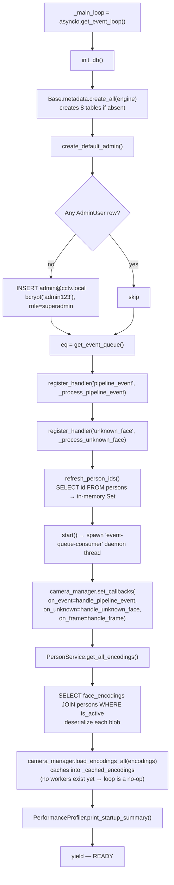

**Failure mode:** if `init_db()` raises (Postgres unreachable), the exception is logged
and **re-raised**, aborting startup. This is the only hard dependency at boot.

## 3.4 Camera activation (deferred, on demand)

Nothing is processing video after startup. The log says
*"📷 Cameras will start when triggered from the dashboard."*

```
POST /api/cameras/{camera_id}/start
│
├─ routes/cameras.py:180 → CameraService.start_camera(camera_id)
│  ├─ SELECT stream_url FROM cameras WHERE id = ?
│  └─ camera_manager.start_camera(camera_id, stream_url)
│     │
│     ├─ guard: already running? → return False
│     ├─ guard: len(_workers) >= MAX_CAMERAS (10)? → return False
│     │
│     ├─ worker = CameraWorker(camera_id, stream_source, on_event, on_unknown, on_frame)
│     │  └─ CameraWorker.__init__ → VisionPipeline(...)
│     │     ├─ FaceDetector()          — logs config, does NOT load ONNX yet
│     │     ├─ FaceRecognizer()        — creates NumpySearchBackend (empty)
│     │     ├─ PersonTracker(on_entry=_handle_entry_event, on_exit=_handle_exit_event)
│     │     ├─ ByteTracker()
│     │     ├─ AttributeRecognizer(max_workers=2)     if ENABLE_ATTRIBUTE_RECOGNITION
│     │     ├─ CrowdDetector(on_alert=_handle_security_alert)   if ENABLE_CROWD_DETECTION
│     │     ├─ LoiteringDetector(on_alert=_handle_security_alert) if ENABLE_LOITERING_DETECTION
│     │     ├─ HazardDetector(on_alert=_handle_security_alert)  if ENABLE_HAZARD_DETECTION
│     │     ├─ PlateRecognizer(...)     if mode in (traffic,hybrid) and ENABLE_ANPR
│     │     ├─ TrafficMonitor(...)      if mode in (traffic,hybrid) and ENABLE_TRAFFIC_MONITOR
│     │     └─ get_reid_tracker()       if ENABLE_REID  (global singleton)
│     │
│     ├─ worker.start()
│     │  ├─ pipeline.start()
│     │  │  ├─ if source startswith "browser:" → _running=True, no capture, RETURN
│     │  │  ├─ cv2.VideoCapture(int(source) if digit else source)
│     │  │  ├─ set CAP_PROP_BUFFERSIZE=1, CAP_PROP_FPS=30
│     │  │  └─ spawn 'grabber-{id}' thread → _grabber_loop()
│     │  ├─ spawn 'jpeg-{id}' thread → _jpeg_encoder_loop()
│     │  └─ spawn 'camera-{id}' thread → _run_loop()
│     │
│     └─ if _cached_encodings: worker.pipeline.recognizer.load_encodings(cached)
│        else: PersonService.get_all_encodings() → load
│        ── comment: "critical: without this every face is UNKNOWN"
```

Then, on the **first processed frame**:

```
_run_loop → pipeline.process_frame()
          → detector.detect_faces_with_embeddings(frame)
          → self._get_app() → _get_insightface_app()
             ├─ FaceAnalysis(name="buffalo_l",
             │               providers=['CUDAExecutionProvider','CPUExecutionProvider'])
             ├─ app.prepare(ctx_id=0, det_size=(640,640), det_thresh=0.60)
             │   ── values from .env, NOT the config.py defaults of 1024/0.5
             └─ VERIFY: iterate app.models['detection'|'recognition'].session.get_providers()
                 if 'CUDAExecutionProvider' absent → log a 70-char-wide CRITICAL banner
                 warning that inference is 10–50× slower, and continue anyway
```

## 3.5 Shutdown

```
lifespan (post-yield)
├─ camera_manager.stop_all()
│  └─ for each worker: stop()
│     ├─ _stop_event.set()
│     ├─ _jpeg_slot_event.set()          — wake encoder so it can exit
│     ├─ pipeline.stop()
│     │  ├─ _grabber_stop.set(); grabber.join(timeout=3)
│     │  ├─ capture.release()
│     │  ├─ tracker.check_exits()        — flush pending exits
│     │  └─ shutdown attribute/hazard/plate/traffic executors (wait=False)
│     ├─ camera thread.join(timeout=5)
│     └─ jpeg thread.join(timeout=3)
└─ eq.stop()
   ├─ _stop_event.set(); consumer.join(timeout=10)
   └─ drain loop: while not queue.empty(): _dispatch(get_nowait())
```

---

# PHASE 4 — REQUEST / EXECUTION FLOWS

## 4.1 The frame pipeline (FACE mode) — stage by stage

### Stage 0 — Frame acquisition

| | |
|---|---|
| **Input** | Hardware camera / RTSP socket |
| **Output** | `np.ndarray` BGR, native resolution |
| **Classes** | `VisionPipeline` |
| **Functions** | `_grabber_loop()` (grabber thread), `process_frame()` (camera thread) |
| **Why it exists** | OpenCV's `VideoCapture` buffers frames internally, and DSHOW on Windows **ignores `CAP_PROP_BUFFERSIZE=1`**. When processing is slower than capture, `read()` returns stale buffered frames — the stream falls behind real time and then visibly "jumps" when the buffer flushes. The grabber thread runs `read()` in a tight loop and overwrites `_grabbed_frame` every time, so the consumer always gets the newest frame and old ones are simply discarded. |

The handoff is a lock-protected take-and-clear:

```python
with self._grab_lock:
    frame = self._grabbed_frame
    self._grabbed_frame = None   # mark consumed
if frame is None:
    return None                  # profiler.record_frame_dropped()
```

For `browser:` sources, the pipeline instead reads `_browser_sessions[sid].last_frame` and
de-duplicates on `last_frame_at` timestamp equality.

### Stage 1 — Frame skip and display-frame construction

| | |
|---|---|
| **Input** | Full-resolution BGR frame |
| **Output** | 1080p `display_frame` (annotated) |
| **Functions** | `resize_frame()`, `_draw_box()`, `_apply_load_degradation()` |

Two resolutions are used deliberately:
- **AI runs on the full-resolution frame** (a 2560×1440 source stays 2560×1440) for
  maximum small-face recall.
- **Drawing + JPEG encoding run on a single 1080p resize.** The comment quantifies the
  win: *"saves ~13 ms/frame (no redundant resize in JPEG thread) and reduces per-frame
  memory from 11.7 MB to 6.2 MB."*

Scale factors `_stream_scale_x/y` are computed once on the first frame; bounding boxes are
computed in full-res space and multiplied down before drawing.

On skipped frames (`_frame_count % FRAME_SKIP != 0`), the cached `_last_face_draws`
(already in display coordinates) are redrawn so boxes do not flicker between detection
frames.

### Stage 2 — Detection + embedding (single pass)

| | |
|---|---|
| **Input** | Full-res BGR frame |
| **Output** | `face_locations: List[(top,right,bottom,left)]`, `embeddings: List[np.ndarray(512)|None]` |
| **Classes** | `FaceDetector` |
| **Functions** | `detect_faces_with_embeddings()` → `_get_app()` → `app.get(frame)` → `_is_valid_face_geometry()` |
| **Profiler stages** | `scrfd_inference`, `scrfd_postprocess` |

This is the single most important optimisation in the codebase: InsightFace's
`FaceAnalysis.get()` runs SCRFD **and** ArcFace in one call, returning `face.bbox`,
`face.kps` (5 landmarks), `face.det_score`, and `face.embedding` together. There is no
separate crop-and-re-embed pass.

**Colour-space correctness.** A prominent comment appears in four places:

> *InsightFace expects BGR input — it does `swapRB=True` internally in both SCRFD and
> ArcFace. Do NOT convert to RGB.*

Migration `005_embedding_v2_migration.sql` documents that this was previously wrong:
every stored embedding had been computed on colour-inverted images. The migration adds an
`encoding_data_v2` column and an `embedding_version` flag so both generations can coexist
during re-computation.

**False-positive rejection.** `_is_valid_face_geometry(face)` is a hand-written geometric
plausibility check on the 5 landmarks, designed to reject vehicle headlights, reflections
and licence plates that SCRFD scores as faces:

1. `det_score >= 0.45` (secondary threshold above SCRFD's own)
2. Eye horizontal separation `eye_dx >= 5` px
3. Eyes roughly level: `eye_dy <= eye_dx * 0.85` (≈ 40° max tilt)
4. Nose horizontally between the eyes: `|nose_x - eye_centre_x| <= eye_dx`
5. Nose not above eye level by more than `0.3 * eye_dx`
6. Mouth below the nose (within `0.2 * eye_dx` tolerance)
7. Aspect sanity: `(mouth_y - eye_y) / eye_dx <= 4.0`

If `kps` is missing entirely, the detection is allowed through (fail-open).

Faces smaller than `min_face_size` (32 px, `MIN_FACE_DETECT_PX`) are dropped here.

### Stage 3 — Multi-object tracking

| | |
|---|---|
| **Input** | `(N,4)` xyxy array + `(N,)` scores (all hard-coded to `1.0`) |
| **Output** | `List[STrack]` with stable `track_id` |
| **Classes** | `ByteTracker`, `STrack` |
| **Functions** | `ByteTracker.update()` → `STrack.predict()` → `_iou_batch()` → `_linear_assignment()` → `STrack.update()` / `activate()` |
| **Profiler stage** | `bytetrack` |

Six steps inside `update()`:

1. Split detections into high (`score >= 0.5`) and low (`0.1 <= score < 0.5`) confidence.
   Since the pipeline passes `1.0` for every detection, **the low-confidence branch is
   effectively dead** in FACE mode.
2. `predict()` every tracked and lost track — constant-velocity extrapolation
   (`bbox += velocity`), where velocity is exponentially smoothed
   `v = 0.7·v_new + 0.3·v_old`. There is no Kalman filter despite the docstring
   mentioning one.
3. Hungarian assignment (`lap.lapjv`, or `scipy.optimize.linear_sum_assignment` fallback)
   on `cost = 1 - IoU`, gated at `match_thresh = 0.8`.
4. Second association pass for unmatched tracks against low-confidence detections at a
   looser 0.5 threshold.
5. Unmatched tracks move to `_lost_stracks` if within `track_buffer` (90 frames), else to
   `_removed_stracks`.
6. **Identity carry-over** for new detections — described in Phase 5.

### Stage 4 — Recognition (gated by cache)

| | |
|---|---|
| **Input** | one 512-d embedding |
| **Output** | `MatchResult` |
| **Classes** | `FaceRecognizer`, `NumpySearchBackend`, `MatchResult` |
| **Functions** | `_should_recognize()` → `recognize_face()` → `NumpySearchBackend.search()` → `_get_adaptive_threshold()` |
| **Profiler stage** | `arcface` |

`_should_recognize(track)` is the gate that saves most of the GPU budget:

```
track.person_id is None            → recognise (reason: "no_identity")
track.tracklet_len < 3             → recognise (reason: "new_track")
track.recognition_locked           → recognise if elapsed >= 3.0 s ("recheck_locked")
otherwise                          → recognise if elapsed >= 1.0 s ("recheck_unlocked")
```

Wall-clock, not frame counts — so behaviour is identical at 5 FPS and 30 FPS.

### Stage 5 — Presence state machine

| | |
|---|---|
| **Input** | `person_id`, `person_name`, `camera_id`, `confidence`, `centroid` |
| **Output** | entry event dict, or `None` |
| **Classes** | `PersonTracker`, `TrackState` |
| **Functions** | `on_detection()`, `check_exits()` |

Called for **every** displayed box — known, unknown, and too-small tracks alike. See
Phase 5.9 for the full state machine.

### Stage 6 — Event dispatch (non-blocking)

```
PersonTracker.on_entry callback
  → VisionPipeline._handle_entry_event(event)
      ├─ enrich with AttributeRecognizer.get_attributes(person_id) if cached
      └─ self.on_event(event)
          → main.handle_pipeline_event(event)          [camera thread]
              ├─ if event_type == "vehicle_count":
              │     broadcast only, no persistence, RETURN
              ├─ priority = CRITICAL if type in (entry, exit, security_alert) else NORMAL
              └─ get_event_queue().put("pipeline_event", event, priority)
```

Cost on the vision thread: one `queue.put_nowait()`.

### Stage 7 — Persistence (event-queue consumer thread)

`_process_pipeline_event(event)` in `main.py:114`:

1. Open `SessionLocal()`.
2. If `camera_id.startswith("bc_")` and no `Camera` row exists → create one on the fly
   (`camera_type="browser"`), because `detection_events.camera_id` is a NOT NULL FK.
3. **Foreign-key guard:** `if person_id and not eq.is_known_person(person_id)` → move the
   ID into `metadata_json["unknown_person_id"]` and set the FK column to `NULL`. This
   prevents FK violations for synthetic IDs like `small_track_7` or unknown-face UUIDs.
4. `INSERT INTO detection_events`.
5. If `event_type == "entry"` and a real `person_id` survived the guard → `INSERT INTO
   tracking_sessions` (status `active`), commit, then loop **all** active camera workers
   calling `worker.pipeline.tracker.set_session_id(person_id, session.id)`.
6. If `event_type == "exit"` and `session_id` present → update `exit_time`,
   `duration_sec`, `status='completed'`.
7. `profiler.record_db_insert(elapsed_ms)` or `record_db_failure()`.
8. `asyncio.run_coroutine_threadsafe(_broadcast_event(event), _main_loop)`.

### Stage 8 — WebSocket delivery

Two independent channels:

**Events** — `WS /api/events/live`. `ConnectionManager.broadcast_event()` JSON-serialises
and `send_text()` to every subscriber, collecting failures and disconnecting them.

**Video** — `WS /api/cameras/{id}/stream`. This does **not** use `ConnectionManager`.
It is a per-connection polling coroutine:

```python
last_jpeg_id = None
while True:
    jpeg = worker.pipeline._last_jpeg          # or browser_session.last_jpeg
    if id(jpeg) != last_jpeg_id:               # object identity as change detection
        last_jpeg_id = id(jpeg)
        await websocket.send_bytes(jpeg)
    await asyncio.sleep(0.01)                  # 100 Hz poll
```

**Fragility to note:** using `id()` for change detection is unsound in CPython — a freed
`bytes` object's address can be reused by a new one, causing a frame to be silently
skipped. Rare, but real. A monotonic counter would be correct.

### Stage 9 — Frontend

`monitor/page.js` handles three event types and ignores the rest:

- `entry` → push a `presenceLog` row with `status:'present'` (de-duplicated by
  `personId` + existing `present` status)
- `exit` → mutate the matching row to `status:'left'` with `duration`
- `unknown` → push an "Unknown Person" row

Video is rendered by pointing an `` at `/api/cameras/{id}/feed` or by consuming the
WebSocket and creating `URL.createObjectURL(blob)` per frame.

## 4.2 Unknown-face flow (end to end)

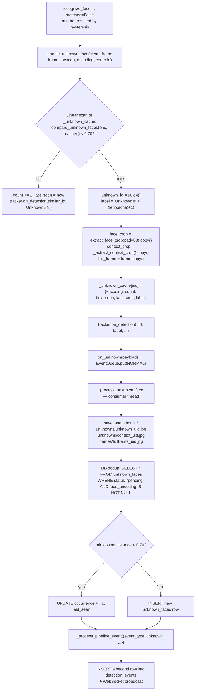

**Two-level de-duplication.** In-memory (per pipeline, `_unknown_cache`) catches
frame-to-frame repeats cheaply. DB-level catches the same stranger across camera restarts
and across cameras. Both use `UNKNOWN_SIMILARITY_THRESHOLD = 0.70` cosine distance.

**Two writes per unknown.** Every new unknown produces one `unknown_faces` row **and**
one `detection_events` row (`event_type='unknown'`). The dashboard's "today_unknown"
counter reads the latter.

**The DB dedup query is unbounded.** It loads *every* pending unknown face with an
encoding into Python and loops in a `for` — O(n) rows × 512-float dot products per new
unknown face. With thousands of pending unknowns this becomes the slowest operation in the
consumer thread.

## 4.3 Enrolment flow (unknown → known person)

```
POST /api/unknown-faces/{id}/enroll   [require_admin]
├─ SELECT unknown_faces WHERE id = ?     → 404 if missing
├─ guard: status must be "pending"        → 400 otherwise
├─ PersonService.create_person({name, role, department, phone, email})
│  └─ also: get_event_queue().add_person_id(new_id)   ← keeps FK guard fresh
├─ deserialize_encoding(face.face_encoding)
│  └─ PersonService.add_face_encoding(person_id, arr, quality=0.8)
│     └─ bump EncodingVersion
├─ PersonService.update_person(id, {avatar_url: snapshot_url})
├─ face.status = "enrolled"; commit
└─ PersonService.get_all_encodings() → camera_manager.load_encodings_all(all)
   └─ every live pipeline's recognizer rebuilds its index immediately
```

`POST /{id}/merge` is identical except it attaches the encoding to an **existing** person
instead of creating a new one — used to broaden an already-enrolled person's pose coverage.

## 4.4 Direct enrolment (image upload)

```
POST /api/persons/{person_id}/encodings   (multipart file)
├─ validate content_type ∈ {image/jpeg, image/png, image/jpg}
├─ cv2.imdecode(np.frombuffer(bytes))
├─ app.get(image)                        ← BGR, no conversion
├─ reject if 0 faces  → 422
├─ reject if >1 face  → 422 ("Please upload an image with exactly one face")
├─ FaceQualityGate().assess(face_crop, face_location, det_score, landmarks)
│   ├─ size >= 80 px, det_score >= 0.55, blur >= 80.0,
│   │  40 <= brightness <= 220, |yaw| <= 45°, |pitch| <= 35°
│   └─ reject with the concatenated list of reasons → 422
├─ PersonService.add_face_encoding(..., yaw, pitch, roll, det_score, blur_score, lighting)
└─ camera_manager.load_encodings_all(get_all_encodings())
```

## 4.5 Offline video analysis

```
POST /api/video-analysis/upload
├─ extension whitelist from ALLOWED_VIDEO_EXTENSIONS
├─ stream to disk in 1 MB chunks, abort + unlink at MAX_VIDEO_SIZE_MB (2000)
├─ saved as {uuid4}.{ext}   ← original filename never touches the filesystem path
└─ VideoAnalysisManager.start_analysis()
   ├─ guard: MAX_CONCURRENT (2) → 429
   └─ VideoAnalysisJob.start() → thread 'video-analysis-{id}'
      └─ _run_analysis()
         ├─ cv2.VideoCapture(path); read fps/frame_count/width/height
         ├─ construct a FRESH detector/recognizer/tracker (not the live ones)
         ├─ optionally construct hazard/anpr/traffic/crowd/loitering/attribute modules
         │   — ANPR is constructed with frame_interval=1 and plate_cooldown_sec=0,
         │     because consolidation handles de-duplication afterwards
         ├─ per frame: skip unless frame_count % VIDEO_ANALYSIS_FRAME_SKIP == 0
         ├─ detect_faces() + batch_generate_encodings() + recognize_face()
         ├─ _track_unknown_face() for misses
         ├─ _build_person_timeline(fps), _build_vehicle_timeline(fps)
         └─ _consolidate_plates() — Levenshtein clustering + _majority_vote_plate()
```

Results live **only in memory** (`VideoAnalysisResult`), keyed by `job_id` in
`VideoAnalysisManager._jobs`. Nothing is persisted to Postgres, so a restart loses all
analysis history.

## 4.6 Browser-camera flow

```
Phone opens GET /share-camera (HTML served by share_camera_page.py)
│
├─ getUserMedia({video}) → <video> → canvas.toBlob('image/jpeg')
├─ WS ws://backend/api/browser-cam/stream/{session_id}?label=...
│
Backend: browser_camera_stream()
├─ accept()  ← NO AUTHENTICATION
├─ _browser_sessions[sid] = BrowserCameraSession(sid, label)
├─ camera_manager.start_camera(sid, f"browser:{sid}")   ← auto-starts a full pipeline
├─ loop: data = await receive_bytes(); if len >= 100: session.feed_frame(data)
│        └─ cv2.imdecode → last_frame, last_jpeg, last_frame_at, frame_count++
└─ finally: is_active=False; stop_camera(sid); pop session after 30 s
```

`GET /api/cameras` merges DB cameras with active browser sessions so they appear in the
same list.

---

# PHASE 5 — THE VISION PIPELINE, REVERSE ENGINEERED

## 5.1 Component map with exact boundaries

| Component | Begins | Ends | Model / algorithm |
|---|---|---|---|
| **SCRFD** | `detector.py:346` `app.get(frame)` | `detector.py:380` return | SCRFD-10G (buffalo_l), ONNX Runtime CUDA |
| **ArcFace** | same `app.get()` call | `face.embedding` field | ArcFace R50, 512-d |
| **ByteTrack (faces)** | `pipeline.py:483` `byte_tracker.update()` | `bytetrack.py:499` return | pure NumPy + `lap`/`scipy` |
| **ByteTrack (vehicles)** | `anpr.py:823` `_vehicle_tracker.update()` | `bytetrack.py:861` | same algorithm + keyframe state |
| **YOLO (person assist)** | `pipeline.py:1362` | `pipeline.py:1387` | YOLOv8n, class 0 only |
| **YOLO/RF-DETR (hazard)** | `hazard_detector.py:230` `_detect()` | `_detect_rfdetr` / `_detect_yolo` | RF-DETR Large → YOLOv8n |
| **Roboflow/RF-DETR/YOLO (traffic)** | `traffic.py:326` `_analyze()` | three `_analyze_*` methods | HTTP API → local |
| **PaddleOCR + EasyOCR** | `anpr.py:1604` `_ocr_region()` | `anpr.py:1688` | dual-engine vote |
| **ReID** | `reid.py:248` `process_person()` | `reid.py:432` | ResNet50 ImageNet, 2048-d |
| **Presence FSM** | `tracker.py:96` `on_detection()` | `tracker.py:259` `check_exits()` | pure Python |

## 5.2 SCRFD — face detection

Loaded once per process by `_get_insightface_app()` (module-level singleton guarded by a
`threading.Lock`, with a `_insightface_failed` sticky flag so a failed load is not retried
on every frame).

`FaceAnalysis(name="buffalo_l")` bundles SCRFD-10G detection **and** ArcFace R50
recognition. `app.prepare(ctx_id=0, det_size=(D,D), det_thresh=T)` where `D` and `T` come
from settings.

**Detection size is the single biggest accuracy/latency lever.** `config.py` documents the
reasoning for its 1024 default:

> *1024 gives ~2.5× better resolution for small faces on 4 MP frames. On a 2560×1440
> source, 1024 letterbox means 0.71× downscale (vs 0.44× at 640), so a 60 px face arrives
> at SCRFD as 43 px not 26 px.*

**The deployed `.env` overrides this to 640.** So the running system is at the *lower*
setting despite the config comment arguing for 1024. Whoever tunes this should know both
numbers exist.

The CUDA verification block is worth highlighting: ONNX Runtime silently falls back to CPU
if the CUDA provider fails to initialise (e.g. onnxruntime < 1.20 on Blackwell/sm_120
hardware). The code inspects `model.session.get_providers()` after `prepare()` and prints
an unmissable banner if CUDA is absent — because the symptom otherwise is just
"everything is 20× slower" with no error.

## 5.3 ArcFace — embeddings and the gallery

**Serialisation.** `serialize_encoding(arr)` → `arr.astype(np.float32).tobytes()` = exactly
2048 bytes. `deserialize_encoding(data)` tries `np.frombuffer` when
`len(data) == FACE_EMBEDDING_DIM * 4`, and falls back to `pickle.loads` for legacy rows.
(The pickle fallback is a security consideration — see Phase 13.)

**Gallery loading** — `FaceRecognizer.load_encodings(encodings_data)`:

1. Clear `_known_faces` and `_person_index`.
2. For each row: deserialize → reject unless `shape == (512,)` → **L2-normalise** →
   append a `KnownFace` → append index to `_person_index[person_id]`.
3. Build the search index: `NumpySearchBackend.build_index(matrix, person_ids,
   encoding_ids, qualities)`.
4. `_cache_version += 1`; log per-person encoding counts.

Because every stored vector is normalised at load time and every query is normalised at
match time, cosine similarity reduces to a single matrix–vector product:
`similarities = self._encodings @ query`.

**Three loading paths:**

| Path | Trigger | Function |
|---|---|---|
| Startup | `lifespan` | `PersonService.get_all_encodings()` → `load_encodings_all()` (cache only) |
| Camera start | `start_camera()` | `_cached_encodings` → `recognizer.load_encodings()` |
| Live refresh | enrolment / merge / approve / delete encoding | `load_encodings_all()` on all workers |
| Safety net | every 300 s per pipeline | `_auto_refresh_encodings()` — reloads if the DB row count differs from `_encoding_db_count` |

The safety net exists specifically because `seed_teachers.py` writes directly to Postgres
**out of process**, so the API-triggered refresh never fires. Its docstring says exactly
that.

## 5.4 Recognition thresholds and the matching decision

`FaceRecognizer.recognize_face(face_encoding, face_quality=0.5)`:

```
Step 0  backend.size == 0  → MatchResult(matched=False, "no_encodings_loaded") + WARNING log
Step 1  normalise query; zero-norm → "zero_norm_embedding"
Step 2  backend.search(query, top_k=backend.size)   ← ALL similarities, not top-k
Step 3  group by person_id, keep best similarity per person
Step 4  sort persons ascending by distance = 1 - similarity
Step 5  threshold, tier = _get_adaptive_threshold(face_quality)
Step 6  margin = second_best_distance - best_distance
Step 7  decide
```

Adaptive threshold table:

| Face quality | Threshold | Tier name | Setting |
|---|---|---|---|
| `>= 0.8` | 0.52 | strict | `FACE_MATCH_STRICT` |
| `>= 0.5` | 0.62 | balanced | `FACE_MATCH_BALANCED` |
| `< 0.5` | 0.72 | lenient | `FACE_MATCH_LENIENT` |

Decision logic:

```
if best_distance <= threshold:
    if margin < FACE_MATCH_MIN_MARGIN (0.10) and len(persons) >= 2:
        → REJECT, rejection_reason="ambiguous_margin"     [logs "❌ AMBIGUOUS"]
    else:
        → MATCH, confidence = best_similarity             [logs "✅ MATCHED"]
else:
    gray_ceiling = threshold + IDENTITY_GRAY_ZONE_UPPER (0.08)
    in_gray_zone = best_distance <= gray_ceiling
    → REJECT, rejection_reason="distance_exceeds_threshold"
      [logs "❌ NO MATCH (GRAY ZONE)" or "❌ NO MATCH (DEFINITE)"]
```

The **margin check** is the defence against confusing two similar-looking enrolled people:
if the best and second-best *persons* are within 0.10 distance of each other, the system
declines to guess rather than risk a false identification.

> ### ⚠️ CONFIRMED DEFECT — adaptive thresholds are dead code
>
> I grepped every call site of `recognize_face`. All four
> (`pipeline.py:562`, `pipeline.py:1518`, `pipeline.py:1771`,
> `video_analysis_service.py:384`) call it with **one positional argument**. The
> `face_quality` parameter always takes its default of `0.5`.
>
> Therefore `_get_adaptive_threshold(0.5)` always returns the **balanced** branch.
> `FACE_MATCH_STRICT` and `FACE_MATCH_LENIENT` are never used at runtime, and the
> effective threshold is permanently 0.62 with a gray ceiling of 0.70.
>
> The only caller that would pass a real quality is `recognize_faces_batch`, which
> itself has zero call sites.

## 5.5 Recognition cache and identity locking

`STrack` carries three cache fields:

| Field | Meaning |
|---|---|
| `recognition_confidence` | best confidence seen for this track |
| `recognition_time` | `time.time()` of the last ArcFace call |
| `recognition_locked` | `True` once `confidence >= RECOGNITION_LOCK_CONFIDENCE (0.85)` |

Once locked, ArcFace runs on that track only every 3 s instead of every 1 s. The intent
(from the config comment) is *"Once a track is confidently recognized, skip ArcFace until
re-check"*.

The profiler measures the effectiveness of exactly this: `Tracks Seen`,
`Recognition Calls`, `Calls Saved`, `Hit Rate`, plus a "Why recognized" breakdown across
the four reason codes.

## 5.6 Identity carry-over (ByteTrack)

When a detection matches no existing track, `ByteTracker.update()` does not immediately
create an anonymous new track. It first searches for a recently-lost track to inherit
from:

```python
best_iou = 0.3            # minimum to consider
for old_track in (self._lost_stracks + self._removed_stracks[-100:]):
    if old_track.person_id and (frame_id - old_track.frame_id) <= track_buffer:
        iou = _iou_batch(old_track.bbox, det_bbox)[0,0]
        if iou > best_iou:
            best_iou = iou
            carried_person_id   = old_track.person_id
            carried_person_name = old_track.person_name
```

The new `STrack` is created already carrying that identity, so a person who was briefly
occluded does not generate a fresh "unknown" event and a duplicate entry.

**The diagnostics around this are unusually thorough** — someone clearly debugged this
hard. On failure the code classifies the reason and logs the entire candidate pool:

- `NEW_PERSON (no tracks within 500px)` — genuinely a new person
- `LOW_IOU (best=0.123, need >0.3)` — candidate existed but boxes didn't overlap enough
- `ZERO_OVERLAP` — candidate existed but no overlap at all

plus pool sizes, the best candidate's centroid distance, frames-lost, and velocity, and a
list of up to 5 nearby candidates. `profiler.record_carryover_success/failed()` feeds a
"Carry-over Success: X/Y (Z%)" line in the periodic report.

## 5.7 Hysteresis, gray zone, and temporal rescue

These three mechanisms exist to stop the label flickering
`Known → UNKNOWN → Known` when a face's ArcFace distance oscillates around the threshold.
All three live in `pipeline.process_frame()` lines 614–699. **This entire block is
uncommitted working-tree code** — it does not exist in `71cfc07`.

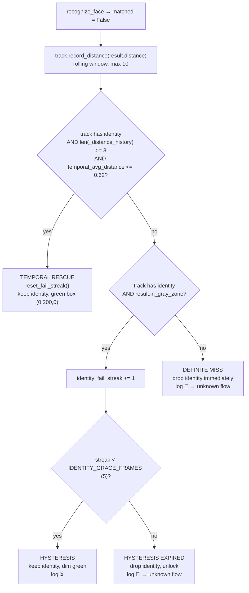

**Precedence matters.** Temporal rescue is checked *first* and is strictly more permissive
than hysteresis: it uses the rolling mean over up to 10 recent frames, so a single bad
frame (motion blur, a head turn) cannot drop an identity that is on average a good match.
Hysteresis is the second line of defence for the case where the average has also drifted
but the current frame is still only borderline.

Three log strings identify which path fired at runtime: `🔄 TEMPORAL RESCUE`,
`⏳ HYSTERESIS`, `🚫 HYSTERESIS EXPIRED` / `🚫 DEFINITE MISS`.

## 5.8 Face-size gating

Two independent thresholds, deliberately separated:

| Setting | Value | Enforced at | Effect |
|---|---|---|---|
| `MIN_FACE_DETECT_PX` | 32 | `FaceDetector.MIN_FACE_SIZE_DEFAULT`, in `detect_faces_with_embeddings` | Below this the face is discarded entirely |
| `MIN_FACE_RECOGNIZE_PX` | 80 | `pipeline.process_frame()` line 532 | Below this the face is **tracked but never identified** |

A 32–80 px face gets an orange box labelled `Track #N` and is fed to `PersonTracker` with
`person_id = f"small_track_{track_id}"` and confidence 0. It counts toward occupancy and
generates entry/exit events, but is never guessed at. The config comment states the
principle: *"never guess on insufficient pixels."*

Consequence to be aware of: those `small_track_*` IDs flow into `detection_events` and are
caught by the FK guard, landing in `metadata_json.unknown_person_id`.

## 5.9 Entry / exit state machine

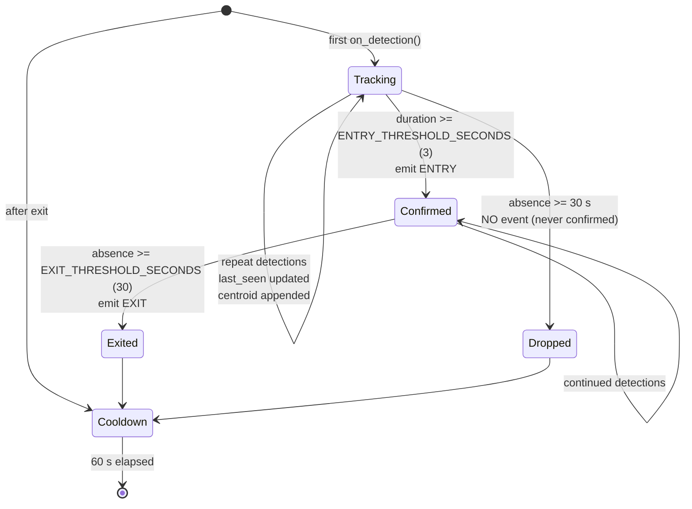

- `on_detection()` is called from the vision thread on every displayed box.
- `check_exits()` is called by `_check_periodic_exits()` every 5 s (`_exit_check_interval`)
  and once more from `pipeline.stop()` to flush.
- The 60 s `cooldown_period` is applied on exit and blocks re-entry counting; while in
  cooldown `on_detection()` returns immediately without tracking.
- `centroid_history` is a `deque(maxlen=600)` of `(ts, cx, cy)` — this is the raw material
  the loitering detector consumes.
- `EXIT_THRESHOLD_SECONDS` was raised from 15 (`.env.example`) to 30 (`config.py`) with the
  comment *"avoids premature exits from brief occlusions."* The deployed `.env` sets 15.

**Not persisted:** `PersonTracker` state is entirely in memory. A restart loses all active
sessions, and the corresponding `tracking_sessions` rows stay `status='active'` forever
with `exit_time = NULL`. There is no reconciliation job.

## 5.10 YOLO-assisted detection

Purpose: SCRFD sometimes misses a face that is clearly a person (heavy angle, partial
occlusion). YOLO finds the *body*, and the pipeline re-runs face detection on just the
head crop at full resolution — a much easier problem than finding a small face in a 4 MP
frame.

`_should_run_yolo_assist(active_tracks, face_locations)` is adaptive, not periodic. It
returns `True` if any of these holds (subject to `_yolo_assist_min_interval`):

1. A track has `person_id is None` and `tracklet_len > 5` — body visible, face not found.
2. A track has an identity but is not locked, with `tracklet_len > 10` — degraded match.
3. A track has an identity and `tracklet_len < 3` — occlusion recovery.
4. `len(tracker.get_person_centroids()) > len(face_locations) + 2` — count mismatch.

Then:

```
_get_yolo_person_detections(clean_frame)     # YOLOv8, conf=0.25, classes=[0]
  └─ _load_yolo_person_detector()
        reuses hazard_detector._model if it is a loaded YOLO backend  ← saves VRAM
_find_missed_persons(yolo_persons, face_locations)
  └─ _face_overlaps_person(): face centre inside person box, OR overlap/face_area > 0.3
for each missed person:
  _attempt_yolo_assisted_detection(frame, clean_frame, person_det)
    ├─ skip if person confidence < 0.30
    ├─ head_region = FaceDetector.estimate_head_region(bbox, shape)
    │     top 40 % of the box, +5 % above, ±10 % horizontally
    ├─ detect_faces_in_crop(head_crop)      # full-res, no downscale
    ├─ if faces found → generate_encoding() → recognize_face() → normal flow
    └─ else → _handle_unknown_person_body()  # body-only unknown
```

Body-only unknowns are de-duplicated by **centroid proximity** (200 px) rather than
embedding — there is no face to embed. They are stored with `encoding=None` and
`detection_type="body_only"`, drawn in orange as `UNKNOWN (body)`, and their cache is
pruned after 60 s of not being seen.

## 5.11 Load-tier degradation

`_apply_load_degradation()` runs after every detection frame and adjusts four knobs based
purely on the current face count:

| Faces | Frame skip | YOLO-assist interval | JPEG quality | Skip P3 work |
|---|---|---|---|---|
| 0–4 | default (3) | 1.0 s | default (80) | no |
| 5–9 | default | 2.0 s | default | **yes** |
| 10+ | `max(FRAME_SKIP, 4)` | 3.0 s | 65 | **yes** |

"P3 work" = attribute extraction and embedding suggestions — the two things you can drop
without affecting identification or safety alerting.

## 5.12 Safety analytics

Run from `_run_safety_analytics()`, throttled to once per second, using only centroid data
already computed — no additional pixel work.

**Crowd detection** (`CrowdDetector.update`)
1. Skip if fewer than `CROWD_MIN_PERSONS` (3) centroids.
2. Build an adjacency map: an edge exists when Euclidean centroid distance
   `<= CROWD_PROXIMITY_PX` (150 px ≈ 1.5 m at typical mounting distance).
3. Find connected components via an explicit stack (single-linkage clustering).
4. Key each cluster by `frozenset(person_ids)`. Merge with an existing gathering when
   Jaccard overlap `> 0.6`, preserving the original `first_detected` so a person joining
   or leaving does not reset the timer.
5. Alert once when `now - first_detected >= CROWD_SUSTAIN_SECONDS` (5 s).
6. Expire gatherings not seen for 5 s.

**Loitering detection** (`LoiteringDetector.update` → `_check_loitering`)
1. Append `(now, cx, cy)` to a per-person `deque(maxlen=600)`.
2. Filter to the last `LOITER_TIME_WINDOW_SEC` (300 s).
3. Require ≥ 10 samples **and** a time span ≥ 80 % of the window — prevents alerting on a
   person who has only just appeared.
4. Compute max displacement from the *first* recorded position.
5. If `max_disp < LOITER_MOVEMENT_THRESHOLD_PX` (50) → alert, subject to a
   `LOITER_ALERT_COOLDOWN_SEC` (600 s) re-alert cooldown.
6. Prune tracks not seen for 60 s.

**Attribute recognition** (`AttributeRecognizer.maybe_extract`)
- Exactly once per track ID, enforced by adding to `_processed_tracks` *before*
  submitting (so concurrent frames cannot double-submit).
- Crops are copied synchronously (the frame reference changes next iteration), then the
  work goes to a 2-thread pool.
- Gender via DeepFace `analyze(actions=["gender"], detector_backend="skip")`.
- Clothing colour via HSV `inRange` masks over a torso region estimated as
  `[face_bottom+5 .. face_bottom + 2·face_height]` horizontally padded by ¼ face width,
  choosing whichever of 11 named ranges has the most matching pixels.
- Results are merged into entry/exit events by `_handle_entry_event` / `_handle_exit_event`.

**Hazard detection** (`HazardDetector`)
- Independent frame counter — `submit_frame` is called *before* the face frame-skip, so it
  samples every 30th raw frame regardless of pipeline skipping.
- Model preference: RF-DETR (Nano/Base/Large) → YOLOv8. Backend recorded in
  `_model_backend`.
- Only two COCO classes are treated as threats: `43: knife`, `76: scissors`. A comment
  explains that `backpack/handbag/suitcase` were removed because they fire on any visible
  bag; detecting genuinely *abandoned* objects needs temporal logic that does not exist.
- Per-class confidence floors (knife 0.50, scissors 0.55) and a `(camera_id, class)`
  cooldown of 30 s.

## 5.13 ANPR (traffic / hybrid modes)

Six stages inside `PlateRecognizer._process()`:

```
1. Vehicles      predetected_vehicles from TrafficMonitor, else _detect_vehicles()
                 (YOLOv8m COCO, classes 2/3/5/7)
2. Track         VehicleByteTracker.update(bboxes, scores, types, confs)
3. Plates A      full-frame plate model @ conf=0.20, imgsz=1280
4. Associate     nearest tracked vehicle by centroid within a 30 % margin
                 → VehicleSTrack.update_keyframe(crop, conf, box, quality)
                    keeps the best crop where
                    combined = plate_conf*0.6 + frame_quality*0.4
4b. Plates B     for tracks with no full-frame plate: _detect_plates_in_crop(vehicle_crop)
5. OCR           only if VehicleSTrack.should_run_ocr(min_frames=3, max_frames=15)
                 → _ocr_region(best_plate_crop)
6. Consensus     _add_vote() → _emit_consensus() on ≥3 votes or track expiry
```

**Keyframe selection** is the core idea: rather than OCR-ing every frame, accumulate the
single clearest plate crop per tracked vehicle and OCR that. The docstring claims this
*"reduces OCR calls by ~80 % while improving accuracy."*

`compute_plate_quality(crop)` = `0.3·size + 0.4·sharpness(Laplacian var/500) + 0.3·contrast(std/80)`.

**Preprocessing** (`_preprocess_plate`) explicitly replaced Real-ESRGAN — the comment
gives the numbers: *"~5 ms vs ~300 ms"*. Pipeline: bicubic upscale to 300 px width →
grayscale → CLAHE (clip 2.5, adaptive grid) → bilateral filter (9,75,75) → unsharp mask
(1.5/−0.5) → deskew via `minAreaRect` when 2° < |angle| < 45°.

**Dual-engine OCR** (`_ocr_region`):

```
paddle_text = _paddle_read(color_image)     # PaddleOCR PP-OCRv4, primary
easy_text   = _easy_read(gray_enhanced)     # EasyOCR, secondary

both present:
    similarity = Levenshtein ratio
    >= 0.7  → agree; conf = max(p,e) * min(1, 1 + (sim - 0.7)); return paddle
    < 0.7   → whichever passes _fix_indian_plate() wins;
              if both/neither valid → higher raw confidence wins
one present → that one
neither     → (None, 0.0)
```

**Indian-plate correction** (`_fix_indian_plate`) is the most domain-specific code in the
repo. Target format `SS DD LLL DDDD`:

1. Single-letter state expansion (`X02HH7256` → `KA02HH7256`) via a 17-entry map — the
   comment notes `KA` frequently merges into a single `X` glyph.
2. State-code correction table (~25 entries): `XA/KK/KS/KN/KH → KA`,
   `HH/NH/WH → MH`, `0L/OL → DL`, etc.
3. Validate against a 36-entry `INDIAN_STATE_CODES` set — **reject outright if invalid**.
4. Position-aware digit/letter repair using `OCR_CHAR_CORRECTIONS` (0↔O, 1↔I, 8↔B, 5↔S,
   6↔G, 2↔Z, D→0, Q→0).
5. Regex validation `^[A-Z]{2}\d{1,2}[A-Z]{1,3}\d{1,4}$`, or the older
   `^[A-Z]{2}\d{2}\d{4}$`.
6. Last resort `_position_aware_fix()` using `OCR_OBLIQUE_CORRECTIONS` for oblique CCTV
   angles (3↔J, 4↔A, 7↔T, 9↔G, U→0, L→1, N→4, H→4).

**Consensus voting** (`_emit_consensus`): votes are clustered by Levenshtein similarity
≥ 0.7 (so `CH01COO109` and `CH01CO0109` merge), the winner is `max(votes, then total
confidence)`, and `consensus_conf = avg_conf * (winner_votes / total_votes)`. A fuzzy
cooldown then suppresses any plate ≥ 70 % similar to one emitted within
`ANPR_PLATE_COOLDOWN_SEC` (60 s).

**Heavy models are disabled** by `self._disable_heavy_models = True`, with per-model
justification in the comments: ESRGAN 200–500 ms/crop + 800 MB VRAM; TrOCR 500 ms + 1 GB;
Qwen2-VL 2–3 s + 4 GB ("destroys realtime"). The code paths remain for offline use.

## 5.14 Traffic monitor

Three detection backends tried in order by `_load_model()`:

1. **Roboflow HTTP API** (if `ENABLE_ROBOFLOW_DETECTION`) — two models called in
   **parallel** on a dedicated 2-thread pool: `indian-vehicles-dataset/2` and
   `people-detection-o4rdr/10`. The comment quantifies the win: *"cuts latency from ~1.5 s
   (sequential) to ~750 ms (parallel)."* Frames are downscaled to 640 px wide and JPEG-70
   encoded before base64 upload, with `sx`/`sy` scale factors to map results back.
2. **RF-DETR** local.
3. **YOLOv8** local (`TRAFFIC_MODEL_PATH`).

**Person-overlap filtering** solves a specific failure: the Indian-vehicles model has no
person class, so it labels people as cars/autos/bikes. A vehicle is discarded if its centre
falls inside a person box expanded by 30 %, or if IoU with a person > 0.3. The YOLO
fallback uses a *lighter* filter (only if `vehicle_area <= person_area * 1.5`, IoU > 0.5)
because a rider legitimately overlaps their own motorcycle.

**Motion filtering** (`_filter_moving_vehicles`) matches vehicles to the previous frame by
same-class centroid within 300 px and only reports those that moved > 15 px, with a grace
period for first sightings and for vehicles that previously moved and have now stopped.
This suppresses permanently parked cars.

**Proximity alerting** (`_check_proximity`): for every person×vehicle pair, alert if
`IoU > 0` or `edge-to-edge distance < TRAFFIC_PROXIMITY_PX` (50 px). Severity is `high`
on overlap, `medium` otherwise. The cooldown key is **`camera_id` alone**, so one alert
suppresses all others on that camera for 15 s.

**Cross-module data sharing.** In hybrid mode, `_process_frame_hybrid` runs face detection
first and writes the face boxes into `traffic_monitor._known_face_zones` so the traffic
module can avoid flagging faces as vehicles. It also reads
`traffic_monitor._last_detections["vehicles"]` under `_detections_lock` and passes it to
ANPR as `predetected_vehicles`, eliminating a duplicate YOLO pass. Both are direct
private-attribute accesses across module boundaries.

## 5.15 Person Re-Identification

- `ReIDFeatureExtractor` is a `__new__`-based singleton wrapping
  `torchvision.models.resnet50(weights=DEFAULT)` with the FC head removed → 2048-d
  avgpool features, L2-normalised. Input transform: `Resize((256,128))` + ImageNet
  normalisation.
- **The docstrings and type hints say 512-d throughout; the actual `_feat_dim` is 2048.**
  A comment explains the change: *"these are already discriminative for person appearance.
  No untrained projection layers needed."* The stale 512 references were not cleaned up.
- `ReIDTracker.process_person()`: crop → extract → if `face_person_id` is known, look up
  that identity directly; else scan the gallery for max cosine similarity; match if
  `>= REID_MATCH_THRESHOLD` (0.65).
- Matched identities update via EMA (`alpha = 0.3`) then re-normalise.
- Per-`(reid_id, camera_id)` sighting cooldown of 5 s.
- Cross-camera event fires when a person appears on a camera not in their prior set.
- LRU eviction by `last_seen` at `REID_GALLERY_MAX_SIZE` (500); sightings capped at 100
  per identity.
- Called from `_process_frame_hybrid` only, every `REID_FRAME_INTERVAL` (10) frames, with
  the body box approximated from the face box as `bottom + 3·face_height` tall and
  `± face_height/2` wide.

**ReID is not reachable in FACE mode.** `_process_frame_hybrid` is the only caller of
`reid_tracker.process_person()`. With the deployed `PIPELINE_MODE=face`, the ReID model is
constructed and the `/api/reid/*` endpoints exist, but the gallery stays empty forever.

## 5.16 Embedding suggestions — and why the feature is dead

The design intent is stated in the service docstring:

> *"The system should learn coverage rather than accumulate images. The goal is not to
> collect the largest number of embeddings, but to maintain a small, diverse, and
> high-quality representation of each person."*

`EmbeddingSuggestionService.evaluate_suggestion()` implements a 6-step diversity ladder,
comparing only against one *representative* embedding per pose bucket rather than all of
them:

| Step | Test | Outcome |
|---|---|---|
| 1 | cosine distance < `SUGGESTION_DUPLICATE_THRESHOLD` (0.15) to any bucket rep or pending suggestion | reject |
| 2 | pose bucket not yet covered | **accept** — "New Left profile" |
| 3 | `quality > max_quality + 0.10` | **accept** — "Better quality" |
| 4 | `blur_score > max_blur * 1.3` | **accept** — "Higher sharpness" |
| 5 | new appearance tag not in the existing set | **accept** — "Different appearance" |
| 6 | frontal with `|yaw|<10, |pitch|<10` and better quality than the current frontal | **accept** — "Improved frontal" |
| — | otherwise | reject — "No additional diversity" |

Pose buckets from `classify_pose_bucket(yaw)`: `frontal` (|yaw| ≤ 15°),
`left`/`right` (15–45°), `extreme_left`/`extreme_right` (> 45°).

Approval enforces `MAX_ENCODINGS_PER_PERSON` (15). At the cap, the API returns
`status: "cap_reached"` plus the three weakest encodings ranked by
`compute_health_score() = 0.4·quality + 0.4·(success/usage) + 0.2·recency(90-day decay)`,
and the admin picks one to replace.

> ### ⚠️ CONFIRMED DEFECT — no suggestion is ever created from the live pipeline
>
> `pipeline.py:1045` calls:
>
> ```python
> quality_result = gate.assess(
>     face_crop=face_crop,
>     det_score=confidence,
>     landmarks=None,
> )
> ```
>
> `FaceQualityGate.assess` (`quality.py:60`) has the signature
> `assess(self, face_crop, face_location, det_score=1.0, landmarks=None)`.
> `face_location` is **required and not supplied**, so this raises
> `TypeError: assess() missing 1 required positional argument: 'face_location'`.
>
> The call is inside `_maybe_suggest_encoding`, whose body is wrapped in
> `except Exception as e: logger.debug(...)`. Because `DEBUG_LOGS` defaults to `False`,
> the failure is completely invisible.
>
> **Net effect:** `suggested_encodings` only ever receives rows if something other than
> the live pipeline writes them. Nothing else does. The entire suggestion subsystem —
> service, DB table, 5 API endpoints, and the frontend UI on the person detail page — is
> unreachable.
>
> Also note that even if fixed, `landmarks=None` means `estimate_pose()` returns
> `(0,0,0)`, so every suggestion would be classified as `frontal` and step 2 would never
> fire.

## 5.17 Pipeline mode comparison

| Capability | `face` | `traffic` | `hybrid` |
|---|---|---|---|
| SCRFD + ArcFace | ✅ | ❌ | ✅ |
| ByteTrack face tracking | ✅ | ❌ | ❌ (recognises per detection, no tracker) |
| Recognition cache / lock | ✅ | — | ❌ (recognises every face every frame) |
| Hysteresis / temporal rescue | ✅ | — | ❌ |
| Entry/exit | ✅ | ❌ | ✅ |
| YOLO-assist | ✅ | ❌ | ⚠️ crashes (see below) |
| Crowd / loitering | ✅ | ❌ | ✅ |
| Hazard | ✅ | ❌ | ✅ |
| ANPR | ❌ | ✅ | ✅ |
| Traffic proximity | ❌ | ✅ | ✅ |
| ReID | ❌ (constructed, never called) | ❌ | ✅ |

> ### ⚠️ CONFIRMED DEFECT — hybrid mode raises `AttributeError` on every frame with a face
>
> `pipeline.py:1849`:
>
> ```python
> if now_assist - self._last_yolo_assist_check >= self._yolo_assist_interval:
> ```
>
> `self._yolo_assist_interval` is **never assigned anywhere**. I grepped the whole
> `app/` tree: the only similarly-named attribute is `_yolo_assist_min_interval`
> (assigned at lines 130, 871, 877, 883).
>
> This line sits **outside** the surrounding `try` block, so the `AttributeError`
> propagates:
> `_process_frame_hybrid` → `process_frame` → `CameraWorker._run_loop`'s broad
> `except Exception` → logs the error, `time.sleep(1)`, `continue`.
>
> **Net effect in hybrid mode:** every detection frame containing at least one face is
> aborted *after* the display frame was built but *before* it is returned. The frame is
> discarded, `_run_loop` sleeps a full second, and the effective frame rate collapses to
> ~1 FPS with a continuous error log.
>
> **Severity is currently latent** because the deployed `backend/.env` sets
> `PIPELINE_MODE=face`. But `config.py`'s default is `"hybrid"` — so any deployment
> without a `.env`, or any operator who switches modes, hits this immediately.
> One-character fix: rename to `_yolo_assist_min_interval`.

---

# PHASE 6 — CLASS MAP

## 6.1 Ownership overview

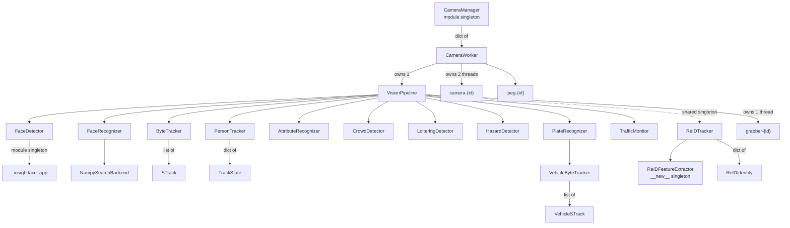

## 6.2 Vision-layer classes

### `VisionPipeline` — `app/vision/pipeline.py:77`

| | |
|---|---|
| **Purpose** | Orchestrate one camera's full per-frame processing. The system's god object. |
| **Created by** | `CameraWorker.__init__` |
| **Owned by** | `CameraWorker` (1:1) |
| **Called by** | `CameraWorker._run_loop` (`process_frame`); `main.py` and routes reach in for `_last_jpeg`, `tracker`, `recognizer` |
| **Lifecycle** | Constructed on `start_camera`, `start()` opens capture + grabber thread, lives until `stop_camera` or shutdown |

**Key fields**

| Field | Type | Purpose |
|---|---|---|
| `camera_id`, `stream_source` | `str` | Identity; `"browser:<sid>"` selects the browser path |
| `on_event`, `on_frame`, `on_unknown` | `Callable` | Wired to `main.handle_*` via `CameraManager` |
| `detector`, `recognizer`, `tracker`, `byte_tracker` | objects | Core sub-modules |
| `attribute_recognizer`, `crowd_detector`, `loitering_detector`, `hazard_detector` | `Optional` | Safety modules, `None` when disabled |
| `plate_recognizer`, `traffic_monitor`, `reid_tracker` | `Optional` | Traffic/hybrid modules |
| `_grabbed_frame`, `_grab_lock`, `_grabber_thread`, `_grabber_stop` | — | Threaded frame grabber |
| `_last_frame`, `_last_jpeg` | `ndarray`, `bytes` | Streaming handoff; `_last_jpeg` written only by the JPEG thread |
| `_unknown_cache` | `Dict[str, dict]` | Face-embedding unknown dedup — **never pruned** |
| `_yolo_body_unknown_cache` | `Dict[str, dict]` | Centroid-based body-unknown dedup — pruned at 60 s |
| `_last_face_draws` | `List[Tuple]` | Display-space boxes redrawn on skipped frames |
| `_stream_scale_x/_y`, `_stream_max_w/_h` | float/int | Full-res → 1080p mapping |
| `_frame_skip_override`, `_jpeg_quality_override`, `_skip_low_priority` | — | Load-tier degradation state |
| `_suggestion_cooldowns` | `Dict[str, float]` | Per-person suggestion throttle |
| `_encoding_db_count`, `_last_encoding_refresh` | — | 300 s gallery safety-net |

**Key methods**

| Method | Role |
|---|---|
| `start()` / `stop()` | Open/close capture, spawn/join grabber, shut down module executors |
| `process_frame()` | Mode dispatcher + the FACE-mode implementation (~410 lines) |
| `_process_frame_hybrid()` / `_process_frame_traffic()` / `_process_frame_traffic_logic()` | Alternate modes |
| `_grabber_loop()` | Grabber thread body |
| `_should_recognize(track)` | Recognition-cache gate |
| `_should_run_yolo_assist()` | Adaptive YOLO-assist trigger |
| `_apply_load_degradation()` | Tiered quality reduction |
| `_auto_refresh_encodings()` | Out-of-process enrolment safety net |
| `_handle_unknown_face()` / `_handle_unknown_person_body()` | Unknown flows |
| `_handle_entry_event()` / `_handle_exit_event()` | Attribute enrichment + forward |
| `_handle_security_alert()` / `_handle_vehicle_event()` / `_handle_vehicle_count()` | Alert forwarding |
| `_maybe_suggest_encoding()` | Suggestion pipeline (currently broken — Phase 5.16) |
| `_draw_box()` / `_extract_context_crop()` / `_update_fps()` | Helpers |
| `status` (property) | Mode-dependent stats dict for `/health` and camera APIs |

---

### `CameraWorker` — `app/vision/camera_worker.py:21`

| | |
|---|---|
| **Purpose** | Own the two threads that drive one pipeline, and decouple JPEG encoding from processing |
| **Created by** | `CameraManager.start_camera` |
| **Owned by** | `CameraManager._workers[camera_id]` |
| **Lifecycle** | `start()` → threads run until `stop()` sets `_stop_event` and joins |

The **single-slot handoff** is the notable design element:

```python
# producer (camera thread)
with self._jpeg_slot_lock:
    self._jpeg_slot_frame = frame     # overwrite — latest wins
self._jpeg_slot_event.set()

# consumer (jpeg thread)
self._jpeg_slot_event.wait(timeout=0.1)
with self._jpeg_slot_lock:
    frame = self._jpeg_slot_frame
    self._jpeg_slot_frame = None
self._jpeg_slot_event.clear()
```

Not a FIFO queue — if the encoder falls behind it simply skips to the newest frame, so
latency never accumulates. The docstring quantifies the benefit: *"The main loop no longer
blocks on JPEG encoding (~28 ms saved per frame)."*

`_run_loop` throttles to a 30 FPS budget (`frame_interval = 1/30`), sleeping only the
remainder after processing.

---

### `CameraManager` — `app/vision/camera_worker.py:202`

Module singleton (`camera_manager` at line 358). Fields: `_workers: Dict[str, CameraWorker]`,
three callback slots, `_cached_encodings: Optional[list]`.

Methods: `set_callbacks`, `start_camera` (enforces `MAX_CAMERAS`), `stop_camera`,
`stop_all`, `load_encodings_all` (caches **and** pushes to every live recognizer),
`refresh_encodings` (re-reads DB then delegates), `get_camera_status`, `get_all_status`,
`get_active_camera_ids`, `get_all_occupancy` (de-duplicates person IDs across cameras).

`_workers` is nominally private but is read directly by `routes/cameras.py`,
`routes/events.py`, `services/analytics_service.py`, and `main.py`.

---

### `FaceDetector` — `app/vision/detector.py:113`

Stateless apart from `_frame_count` and a lazily-fetched reference to the module-level
`_insightface_app` singleton — so constructing one per pipeline costs nothing in VRAM.

Methods: `detect_faces`, **`detect_faces_with_embeddings`** (the hot path),
`detect_faces_raw`, `detect_faces_in_crop`, `extract_face_crop`, `assess_face_quality`,
static `_is_valid_face_geometry`, static `estimate_head_region`, static
`location_to_xyxy` / `xyxy_to_location`.

Coordinate convention throughout the codebase is `(top, right, bottom, left)` — inherited
from the `face_recognition` library this project migrated away from. `xyxy` conversions
happen at the ByteTrack and YOLO boundaries.

---

### `FaceRecognizer` / `KnownFace` / `MatchResult` — `app/vision/recognizer.py`

`FaceRecognizer` fields: `_known_faces: List[KnownFace]`,
`_person_index: Dict[str, List[int]]`, `_backend: SearchBackend`, `_lock: RLock`,
`_encoding_count`, `_cache_version`, and the four threshold values.

`MatchResult` is a rich dataclass — beyond `matched`/`person_id`/`confidence` it carries
`distance`, `quality_tier`, `margin`, `top_k` (the ranked candidate list),
`rejection_reason`, and `in_gray_zone`. The pipeline's hysteresis logic depends on
`in_gray_zone` and `distance`.

One `FaceRecognizer` instance exists **per pipeline**, each holding its own full copy of
the normalised embedding matrix. With a few hundred embeddings that is negligible
(500 × 512 × 4 B ≈ 1 MB per camera).

---

### `ByteTracker` / `STrack` — `app/vision/bytetrack.py`

`STrack` is a dataclass holding `bbox`, `score`, `person_id`, `person_name`,
`tracklet_len`, `_velocity`, plus the recognition-cache trio and the hysteresis pair
(`identity_fail_streak`, `_distance_history` with a `temporal_avg_distance` property).

`ByteTracker` maintains three lists (`_tracked_stracks`, `_lost_stracks`,
`_removed_stracks`), a monotonic `_frame_id` and `_next_id`. `_removed_stracks` is capped
at 1000 and trimmed to the last 500.

Module functions: `_iou_batch(bboxes1, bboxes2)` (vectorised) and
`_linear_assignment(cost_matrix, thresh)` (`lap.lapjv` with a `scipy` fallback).

---

### `VehicleByteTracker` / `VehicleSTrack` — `app/vision/bytetrack.py:547+`

Same association algorithm, different state. `VehicleSTrack` adds `vehicle_type`,
`vehicle_conf`, the keyframe quartet (`best_plate_crop`, `best_plate_conf`,
`best_plate_box`, `best_frame_quality`), and `ocr_votes` / `ocr_emitted`.

Methods unique to it: `update_keyframe()` (only replaces when strictly better),
`should_run_ocr(min_frames, max_frames)` (fires at exactly `tracklet_len == min_frames`,
then every 5th frame up to `max_frames`), `add_ocr_vote()`, and the static
`compute_plate_quality()`.

`VehicleByteTracker` also exposes `get_expired_tracks()` (drains `_removed`) and
`get_lost_tracks_with_votes()` for end-of-stream flushing.

---

### `PersonTracker` / `TrackState` — `app/vision/tracker.py`

Thread-safe via `threading.RLock`. Fields: `_active_tracks: Dict[str, TrackState]`,
`_cooldowns: Dict[str, float]`, `_total_entries`, `_total_exits`.

Methods: `on_detection`, `check_exits`, `get_active_persons` (confirmed only),
`is_person_present`, `get_occupancy`, `set_session_id`, `get_person_centroids`,
`get_person_names`, `reset`, `stats`.

`TrackState` carries `centroid_history: deque(maxlen=600)` and computed properties
`duration` and `time_since_last_seen`.

---

### Safety classes — `app/vision/safety_analytics.py`

| Class | State | Threading |
|---|---|---|
| `AttributeRecognizer` | `_processed_tracks: set`, `_results: Dict[str,dict]` | 2-thread pool, `threading.Lock` |
| `CrowdDetector` | `_gatherings: Dict[frozenset, GatheringState]` | `threading.Lock` |
| `LoiteringDetector` | `_tracks: Dict[str, LoiteringTrack]` | `threading.Lock` |

`GatheringState` = `(person_ids: frozenset, first_detected, last_seen, alerted)`.
`LoiteringTrack` = `(person_id, person_name, history: deque(600), alerted, last_alert_time)`.

---

### `HazardDetector`, `PlateRecognizer`, `TrafficMonitor`

All three share the same shape:
- Lazy `_load_model()` guarded by a lock and a sticky `_loaded` flag.
- `submit_frame(frame, camera_id)` increments an internal counter, returns `False` on
  non-Nth frames, otherwise `frame.copy()` and `executor.submit(...)`.
- Cooldown dict + lock.
- `stats` property.
- `shutdown()` → `executor.shutdown(wait=False)`.

`PlateRecognizer` is the largest: it carries **both** the new `VehicleByteTracker` and a
legacy ad-hoc tracker (`_tracked_vehicles`, `_next_track_id`, `_match_track`, `_box_iou`),
and feeds votes into both.

---

### `ReIDTracker` / `ReIDFeatureExtractor` / `ReIDIdentity` / `ReIDSighting` — `app/vision/reid.py`

`ReIDFeatureExtractor` is a `__new__`-based singleton (one ResNet50 for the whole process).
`ReIDTracker` is a module singleton via `get_reid_tracker()`. `ReIDIdentity` holds the EMA
feature vector, `first_seen`/`last_seen`, a `sightings` list, and optional links to a
face-recognition `person_id`, plus `cameras_seen` and `trail` properties.

## 6.3 Infrastructure classes

| Class | File | Purpose | Lifecycle |
|---|---|---|---|
| `EventQueue` | `core/event_queue.py` | Priority bus + person-ID FK cache | Singleton via `get_event_queue()`; thread started in `lifespan` |
| `EventPriority` | same | `CRITICAL=0`, `NORMAL=1` | Enum |
| `PerformanceProfiler` | `core/profiler.py` | Aggregate metrics | Singleton `profiler` created at import |
| `ConnectionManager` | `core/websocket.py` | WS registries + broadcast | Singleton `ws_manager` |
| `RequestLoggingMiddleware` | `core/middleware.py` | Slow/error request logging | One instance per app |
| `MockStore` | `core/mock_store.py` | **Dead** — self-documented as deprecated | Never instantiated |
| `SearchBackend` (ABC) / `NumpySearchBackend` | `vision/search_backend.py` | Similarity search | One per `FaceRecognizer` |
| `FaceQualityGate` / `QualityResult` | `vision/quality.py` | Enrolment gate + pose estimation | Constructed per call |
| `BrowserCameraSession` | `routes/browser_camera.py` | Per-phone frame buffer | Created on WS connect, popped 30 s after disconnect |
| `PipelineBenchmark` | `vision/benchmarks.py` | **Dead** compat shim | Singleton, zero importers |

## 6.4 Service and job classes

| Class | Style | Notes |
|---|---|---|
| `AuthService`, `PersonService`, `CameraService`, `AnalyticsService`, `MovementService`, `EmbeddingSuggestionService` | all `@staticmethod` | No instances are ever created; each method opens and closes its own `SessionLocal()` |
| `VideoAnalysisResult` | data holder | `to_dict()` / `to_status_dict()` |
| `VideoAnalysisJob` | thread owner | `start`, `stop`, `_run_analysis` (~470 lines), plus timeline builders and plate consolidation |
| `VideoAnalysisManager` | registry singleton | `video_analysis_manager`; `_jobs: Dict[str, VideoAnalysisJob]`, enforces `VIDEO_ANALYSIS_MAX_CONCURRENT` |

---

# PHASE 7 — FILE MAP

Only files with meaningful logic are listed. "Owns" distinguishes behaviour from data.

## 7.1 Backend — entry and configuration

| File | Why it exists | Exports | Imported by | Owns | Critical functions |
|---|---|---|---|---|---|
| `run.py` | Process entry point | `main()` | — (CLI) | logic | Sets CUDA env **before** torch, silences loggers, `uvicorn.run(workers=1)` |
| `app/main.py` | FastAPI app + the bridge between vision callbacks and persistence | `app` | uvicorn | logic | `lifespan`, `handle_pipeline_event`, `handle_unknown_face`, `_process_pipeline_event`, `_process_unknown_face`, `_broadcast_event` |
| `app/config.py` | Single source of runtime truth | `settings`, `Settings` | ~25 modules | data | `cors_origins_list` property; creates 2 directories as an import side effect |
| `app/database.py` | Backwards-compat shim | `get_db`, `init_db`, `create_default_admin`, `SessionLocal` | legacy imports | — | re-export only |

## 7.2 Backend — core

| File | Why | Exports | Imported by | Owns | Critical functions |
|---|---|---|---|---|---|
| `core/event_queue.py` | Keep the vision thread free of I/O | `EventQueue`, `EventPriority`, `get_event_queue` | `main`, `person_service` | logic + data | `put`, `_consumer_loop`, `_dispatch`, `refresh_person_ids`, `is_known_person`, `add_person_id`, `remove_person_id` |
| `core/profiler.py` | Diagnose performance without log spam | `profiler`, `PerformanceProfiler` | vision + main | logic + data | `measure` (ctx mgr), `tick_frame`, `_print_report`, `_get_gpu_stats`, `_get_cpu_stats`, `print_startup_summary`, 15 `record_*` methods |
| `core/security.py` | Auth primitives | `hash_password`, `verify_password`, `create_access_token`, `decode_access_token`, `get_current_user`, `require_admin`, `verify_token` | all routers | logic | `verify_token` exists specifically for WebSocket handlers where HTTP Bearer deps don't apply |
| `core/websocket.py` | WS fan-out | `ws_manager`, `ConnectionManager` | `main`, `events`, `cameras` | logic + data | `connect_events`, `broadcast_event`, `send_frame` (unused) |
| `core/middleware.py` | Observability without breaking CORS | `RequestLoggingMiddleware` | `main` | logic | `__call__` with `send_wrapper` for status capture + `X-Request-ID` |
| `core/exceptions.py` | Consistent error shapes | 5 exception classes | routes + services | — | `NotFoundException(404)`, `DuplicateException(409)`, `ValidationException(422)`, `CameraException(500)`, `PipelineException` |
| `core/mock_store.py` | **Dead** | `MockStore` | nobody | — | — |

## 7.3 Backend — persistence

| File | Why | Exports | Imported by | Owns |
|---|---|---|---|---|
| `db/models.py` | Table definitions | 8 ORM classes + `Base`, `gen_uuid`, `utcnow` | services, routes, main | data |
| `db/session.py` | Engine + session factory + bootstrap | `engine`, `SessionLocal`, `get_db`, `init_db`, `create_default_admin` | everywhere | logic |
| `models/person.py` | API schemas | `PersonCreate/Update/Response`, `PersonWithHistory`, `FaceEncodingCreate/Response` | `routes/persons` | data |
| `models/camera.py` | API schemas **+ the only real input sanitisation in the codebase** | `CameraBase/Create/Update/Response` | `routes/cameras` | data + validation |
| `models/event.py` | API schemas | `DetectionEventCreate/Response`, `TrackingSessionResponse`, `UnknownFaceResponse`, `EnrollUnknownFace`, `MergeUnknownFace`, `LiveDetectionEvent` | `routes/events`, `routes/unknown_faces` | data |
| `models/movement.py` | API schemas | `MovementCreate/Response/Summary/Timeline` | `routes/movements` | data |
| `models/auth.py` | API schemas | `LoginRequest`, `TokenResponse`, `AdminUserCreate/Response` | `routes/auth` | data |

`models/camera.py` deserves attention: it is the only module doing defensive validation.
`validate_stream_url` whitelists four patterns (`^\d+$`, `^rtsp://`, `^https?://`,
`^/dev/video\d+$`) and rejects any string containing shell metacharacters
(semicolon, pipe, ampersand, backtick, dollar, parentheses, braces, CR/LF).
`sanitize_name` / `sanitize_location` strip `< > & ' " \`. This is defence against
command injection into `cv2.VideoCapture` and stored XSS.

## 7.4 Backend — vision (see Phase 5 for behaviour)

| File | Exports | Imported by | Owns |
|---|---|---|---|
| `vision/pipeline.py` | `VisionPipeline` | `camera_worker` | logic |
| `vision/camera_worker.py` | `CameraWorker`, `CameraManager`, `camera_manager` | main, routes, services | logic + data |
| `vision/detector.py` | `FaceDetector`, `_get_insightface_app`, `VehiclePlateDetector`, `get_vehicle_plate_detector`, `COCO_VEHICLE_CLASSES` | pipeline, recognizer, persons route, seed scripts | logic + model singleton |
| `vision/recognizer.py` | `FaceRecognizer`, `MatchResult`, `KnownFace`, `serialize_encoding`, `deserialize_encoding` | pipeline, person_service, unknown_faces, embedding_suggestions, main | logic |
| `vision/bytetrack.py` | `ByteTracker`, `STrack`, `VehicleByteTracker`, `VehicleSTrack` | pipeline, anpr | logic |
| `vision/tracker.py` | `PersonTracker`, `TrackState` | pipeline, video_analysis | logic |
| `vision/search_backend.py` | `SearchBackend`, `NumpySearchBackend`, `create_search_backend` | recognizer | logic |
| `vision/quality.py` | `FaceQualityGate`, `QualityResult` | persons route, pipeline | logic |
| `vision/safety_analytics.py` | `AttributeRecognizer`, `CrowdDetector`, `LoiteringDetector`, `GatheringState`, `LoiteringTrack` | pipeline, video_analysis | logic |
| `vision/hazard_detector.py` | `HazardDetector`, `THREAT_CLASSES` | pipeline, video_analysis | logic |
| `vision/anpr.py` | `PlateRecognizer`, `_fix_indian_plate`, `INDIAN_STATE_CODES` | pipeline, video_analysis, diagnostic scripts | logic |
| `vision/traffic.py` | `TrafficMonitor`, `detect_vehicle_color`, `ROBOFLOW_CLASS_MAP` | pipeline, video_analysis | logic |
| `vision/reid.py` | `ReIDTracker`, `get_reid_tracker`, `ReIDIdentity`, `ReIDSighting` | pipeline, routes/reid | logic |
| `vision/benchmarks.py` | `pipeline_bench`, `PipelineBenchmark` | **nobody** | dead |

## 7.5 Backend — utilities

| File | Exports | Critical detail |
|---|---|---|
| `utils/image_utils.py` | `save_snapshot`, `resize_frame`, `frame_to_jpeg_bytes`, `get_jpeg_encoder_name`, `validate_image_file` | Encoder selection happens **at import**. Benchmarked in the docstring: simplejpeg 5.4 ms vs OpenCV 19.1 ms at 1080p, a 3.5× speedup. `frame_to_jpeg_bytes` tries simplejpeg → TurboJPEG → OpenCV. `save_snapshot` writes relative to the CWD (`"snapshots/..."`), **not** `settings.SNAPSHOT_DIR` — these agree only because the default is `./snapshots`. |
| `utils/time_utils.py` | `utc_now`, `utc_now_iso`, `parse_iso_datetime`, `format_duration`, `today_start_utc`, `days_ago_utc` | Pure helpers. Sparsely used — most modules call `datetime.now(timezone.utc)` directly. |

## 7.6 Standalone scripts (`backend/*.py`)

| Script | Purpose | Notes |
|---|---|---|
| `seed_teachers.py` | Enrol 5 teachers × 5 photos each from `Teachers/` | Writes **directly** to Postgres, bypassing the API. Groups files by a `"{prefix} (N).jpeg"` glob. Three fallback paths for locating the directory, the last of which is a **hard-coded absolute Windows path**. Fixes Windows console encoding for emoji output. |
| `seed_student.py` / `seed_mukesh.py` | Same for `Student/` | |
| `migrate_embeddings.py` | Recompute embeddings into `encoding_data_v2` per migration 005 | |
| `cleanup_unknowns.py` | Bulk-clear the unknown queue | |
| `check_face_encodings.py`, `check_modules.py`, `debug_recognition.py`, `diagnose_anpr.py` | Diagnostics | |
| `test_face.py`, `test_safety_modules.py`, `test_anpr_direct.py`, `quick_plate_test.py` | Manual scripts, **not pytest** | |
| `train_plate_detector.py`, `train_indian_plate_detector.py` | YOLO fine-tuning | |
| `demo_safety.py` | Demo driver | |

**There is no automated test suite.** No pytest/unittest config, no CI workflow, no
`tests/` directory. The `test_*.py` files are interactive scripts.

## 7.7 Frontend

| File | Purpose | Notes |
|---|---|---|
| `lib/api.js` | Single API client | `connectLiveEvents` is **defined twice** (lines 275 and 319); the second silently overrides the first. WS connections are opened **without the JWT token**, despite both server endpoints accepting `?token=`. |
| `lib/AuthContext.js` | Auth state | Validates on mount, refreshes every 30 min, logs out on failure |
| `lib/ThemeContext.js` | Light/dark | Writes `data-theme` on `<html>`, persisted in `localStorage` |
| `lib/ToastContext.js` | Notifications | |
| `lib/useKeyboardShortcuts.js` | Global hotkeys | |
| `app/layout.js` | Root layout | Inlines a blocking theme script to prevent FOUC; provider order `Theme → Auth → ErrorBoundary → Toast` |
| `app/page.js` | Dashboard | |
| `app/monitor/page.js` | Live monitor (761 L) | Presence log from WS events + 3 s active-persons poll |
| `app/video-analysis/page.js` | Upload + results (1,610 L) | Largest frontend file |
| `app/unknown-faces/page.js` | Enrolment queue (804 L) | |
| `app/persons/[id]/page.js` | Person detail (679 L) | Hosts the encoding-management and suggestion UI (currently always empty — Phase 5.16) |
| `app/traffic/`, `app/security-alerts/`, `app/reid/`, `app/events/`, `app/analytics/`, `app/cameras/`, `app/login/`, `app/share-camera/` | Feature pages | |
| `components/DetectionOverlay.js` | Canvas overlay for client-side RF-DETR | |
| `public/rfdetr-worker.js` | WebGPU inference Web Worker | Uses `@huggingface/transformers` |
| `components/*` | 16 presentational components | ActivityFeed, ActivityHeatmap, AppShell, CameraHealth, ErrorBoundary, HourlyChart, Icons, Lightbox, OccupancyRing, PersonTimeline, ProtectedRoute, SearchPalette, Sidebar, Skeleton, StatCard |

## 7.8 Build and deployment

| File | Notes |
|---|---|
| `backend/Dockerfile` | `python:3.11-slim`. Installs cmake/boost/x11/atlas — dependencies for **dlib**, which the project no longer uses (migrated to InsightFace). **No CUDA base image**, so `onnxruntime-gpu` cannot use the GPU inside this container. |
| `frontend/Dockerfile` | Next.js standalone build |
| `docker-compose.yml` | Two services. Passes `/dev/video0` through (Linux only). Sets `NEXT_PUBLIC_API_URL=http://backend:8000`, **but** `next.config.mjs` rewrites are hard-coded to `http://localhost:8000` — inside the frontend container that resolves to the frontend itself, so proxied requests break. No `db` service: Postgres must be external. |
| `backend/requirements.txt` | 33 entries. **`torch`/`torchvision` are not listed** (pulled transitively by ultralytics/rfdetr). **`paddleocr` is not listed** despite being the primary OCR engine. `realesrgan`, `basicsr`, `transformers` also absent (behind the disabled-heavy-models flag). |

---

# PHASE 8 — DATABASE

## 8.1 Entity–relationship diagram

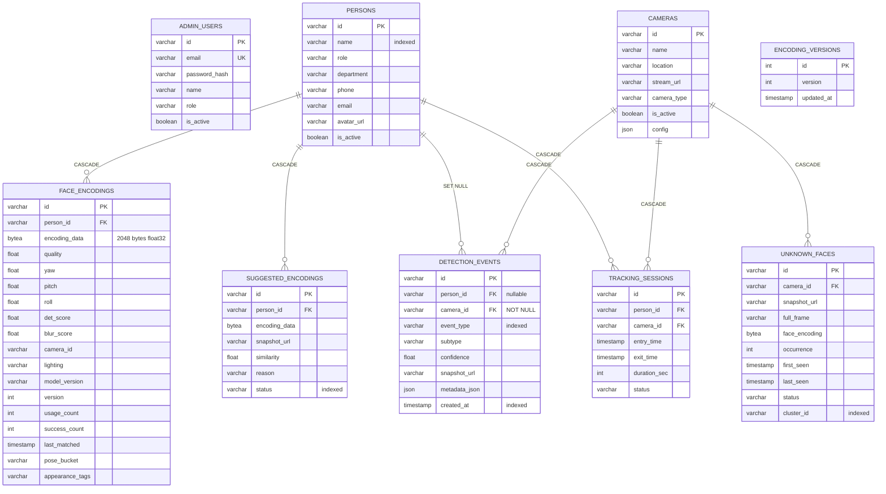

## 8.2 Table-by-table

### `persons`
The identity registry. **Soft delete only** — `delete_person` sets `is_active = False`.
`get_all_encodings()` filters on `Person.is_active == True`, so deactivating a person
removes them from recognition on the next gallery reload without losing history.

### `face_encodings`
The recognition gallery. `encoding_data` is `LargeBinary` holding exactly 2048 bytes
(512 × float32). Rich metadata: pose (`yaw`/`pitch`/`roll`), quality (`det_score`,
`blur_score`), capture context (`camera_id`, `capture_distance`, `lighting`), versioning
(`model_version`, `version`), and health tracking (`usage_count`, `success_count`,
`last_matched`, `pose_bucket`, `appearance_tags`).

> **Note:** `usage_count`, `success_count`, and `last_matched` are **written by nothing**.
> `compute_health_score()` reads them, so every encoding scores identically on the
> effectiveness term (0.1 for "never used") and the recency term (0.05 for "never
> matched"). Health ranking therefore degenerates to `0.4 × quality + 0.15`.

### `detection_events`
The append-only event log. `event_type` values actually emitted at runtime:
`entry`, `exit`, `unknown`, `security_alert`, `vehicle_entry`.
`detection` is defined in schemas and filters but **never emitted**.
`vehicle_count` is broadcast over WebSocket but explicitly **not persisted**
(`main.py:85-91`).

`subtype` discriminates security alerts: `gathering`, `loitering`, `hazard`,
`vehicle_proximity`.

`metadata_json` is a JSON column holding everything not mapped to a real column — for
unknown persons it holds `unknown_person_id`; for alerts it holds bounding boxes, person
counts, and thresholds.

Composite indexes: `ix_events_type_created (event_type, created_at)` and
`ix_events_camera_created (camera_id, created_at)` — well matched to the actual query
patterns in `events.py` and `analytics_service.py`.

### `tracking_sessions`
Created on `entry`, closed on `exit`. **Only for persons that pass the FK guard** — an
`entry` event whose `person_id` was nulled produces a `detection_events` row but no
session. Sessions orphaned by a restart stay `active` forever; there is no reconciler.

### `unknown_faces`
Where strangers accumulate. `face_encoding` stores the raw float32 blob for dedup.
`occurrence` increments each time a matching face is re-detected. `status` moves
`pending → enrolled | dismissed`.

`cluster_id` exists in the model and has an index, **but nothing ever writes it**. The
intended "group all sightings of the same unknown person" clustering was never implemented
— de-duplication is done live via the linear encoding scan instead.

### `suggested_encodings`
Admin approval queue for auto-proposed embeddings. Fully implemented service + API +
frontend, but **permanently empty** in practice (Phase 5.16).

### `encoding_versions`
A single-row table (`id = 1`) holding a monotonic counter bumped on every gallery mutation.
Designed for incremental cache sync. **Currently read by nothing that matters** — the
refresh path always does a full reload. It is infrastructure for an optimisation that was
never wired up.

### `cameras` / `admin_users`
Straightforward. Browser cameras get rows auto-created by `_process_pipeline_event` and
`_process_unknown_face` when `camera_id.startswith("bc_")`.

## 8.3 Migration strategy

**There is no migration tool.** No Alembic, no versioning table, no `alembic.ini`.

Two parallel mechanisms exist, and they disagree:

1. **`Base.metadata.create_all(engine)`** in `init_db()` — creates missing tables from the
   ORM on every startup. It **never alters existing tables**. Adding a column to
   `db/models.py` will not add it to a database that already has the table.
2. **`app/migrations/*.sql`** — five hand-written files that must be run manually. Their
   headers say *"Run this in your Supabase SQL Editor"*, a leftover from the pre-PostgreSQL
   architecture.

**Divergences between the SQL files and the ORM that I verified:**

| Aspect | `001_initial_schema.sql` | `db/models.py` |
|---|---|---|
| Primary keys | `UUID DEFAULT uuid_generate_v4()` | `String(36)` with a Python-side default |
| Encoding storage | `TEXT` ("Base64-encoded pickle") | `LargeBinary` (raw float32) |
| Event metadata column | `metadata` | `metadata_json` |
| `event_type` | `CHECK` constraint, 4 values | no constraint |
| RLS policies | enabled on 7 tables | not applicable |
| Views | `active_occupancy`, `daily_summary`, `movements`, `movement_heatmap`, `security_alerts` | none referenced by any query |

`003` and `004` are `ALTER TABLE ... ADD COLUMN IF NOT EXISTS` — genuinely idempotent and
usable. `005` adds `encoding_data_v2` and `embedding_version`, and its trailer documents a
three-step manual rollout (run `migrate_embeddings.py`, verify accuracy, copy v2 over v1,
wait a week, drop the column).

**Practical guidance for a maintainer:** on a fresh database, `create_all` produces the
correct schema and the SQL files are unnecessary. On an existing database, schema changes
must be applied by hand. Adopting Alembic should be a priority.

## 8.4 Read/write matrix

| Table | Written by | Read by |
|---|---|---|
| `persons` | `PersonService.create/update/delete`, `enroll_unknown_face`, seed scripts | list/get person, `get_all_encodings`, search, analytics, `EventQueue.refresh_person_ids` |
| `face_encodings` | `PersonService.add_face_encoding`, `approve_suggestion`, seed scripts | `get_all_encodings` (gallery), `get_person_encodings`, `evaluate_suggestion` |
| `detection_events` | `_process_pipeline_event` (consumer thread) | events/movements/analytics/search/retention |
| `tracking_sessions` | `_process_pipeline_event` | sessions list, person history, reports |
| `unknown_faces` | `_process_unknown_face`, enroll/merge/dismiss | unknown queue, suggestions, search, retention |
| `suggested_encodings` | `EmbeddingSuggestionService.create_suggestion` (**never reached**) | suggestion endpoints |
| `cameras` | `CameraService` CRUD, auto-create for `bc_*` | list/get, `start_camera` |
| `admin_users` | `create_default_admin`, `AuthService.create_admin` | login |
| `encoding_versions` | `_set_version` on any encoding mutation | `_get_or_create_version` only |

## 8.5 Query patterns and known inefficiencies

- **N+1 in `list_persons`** — one `COUNT(*)` on `face_encodings` per person returned.
  With `limit=50` that is 51 queries. A `GROUP BY` join would be one.
- **Unbounded scan in unknown dedup** — `_process_unknown_face` loads every pending
  unknown with an encoding and loops in Python.
- **`total = query.count()` before every paginated fetch** — doubles the query count on
  every list endpoint.
- **No connection reuse per request** — `SessionLocal()` per service method means a single
  endpoint can open 3–4 connections against a pool of 10 (+20 overflow).
- **Date filters accept raw strings** — `query.filter(DetectionEvent.created_at >= start_date)`
  passes a user string straight to the driver. Safe from injection (parameterised), but an
  unparseable value surfaces as a 500 rather than a 422.

## 8.6 Embedding storage — the complete path

```
Enrolment
  image -> app.get(BGR) -> face.embedding (512 float32, unnormalised)
        -> serialize_encoding() -> arr.astype(float32).tobytes() -> 2048 bytes
        -> FaceEncoding.encoding_data (LargeBinary)

Loading
  get_all_encodings() -> deserialize_encoding(bytes)
      len == 2048 -> np.frombuffer(float32).copy()
      else        -> pickle.loads(...)          [legacy fallback]
  -> FaceRecognizer.load_encodings() -> L2-normalise -> NumpySearchBackend.build_index()

Matching
  query embedding -> L2-normalise -> encodings_matrix @ query -> similarities
  -> distance = 1 - similarity -> group by person -> threshold + margin
```

Unknown-face encodings follow the same serialisation into
`unknown_faces.face_encoding`, and are moved verbatim into `face_encodings` on enrolment.

---

# PHASE 9 — CONFIGURATION

All settings live in `app/config.py` as a `pydantic_settings.BaseSettings` subclass,
overridden by `backend/.env` (`case_sensitive = True`).

## 9.1 Deployed values that differ from code defaults

I read the actual `backend/.env`. These overrides are in force:

| Setting | `config.py` default | Deployed `.env` | Consequence |
|---|---|---|---|
| `INSIGHTFACE_DET_SIZE` | 1024 | **640** | Small-face recall is at the lower setting despite the config comment arguing for 1024 |
| `INSIGHTFACE_DET_THRESH` | 0.5 | **0.60** | Stricter detection, fewer false positives, more missed faces |
| `PIPELINE_MODE` | `hybrid` | **`face`** | Masks the hybrid-mode `AttributeError` (Phase 5.17) |
| `JWT_SECRET_KEY` | `""` | **`your-super-secret-jwt-key-change-this`** | Placeholder secret in production — see Phase 13 |
| `ROBOFLOW_API_KEY` | `""` | **`your-roboflow-api-key-here`** | Roboflow calls will fail auth; `TrafficMonitor` falls through to RF-DETR/YOLO |

## 9.2 Database and auth

| Key | Default | Used by | Effect / tuning |
|---|---|---|---|
| `DB_HOST/PORT/NAME/USER/PASSWORD` | localhost:5432/sentinelai/postgres/postgres | `db/session.py` | Connection URL |
| `DB_ECHO` | `False` | engine | `True` logs all SQL — very noisy, debug only |
| `JWT_SECRET_KEY` | `""` | `core/security.py` | **Must be a strong random value.** |
| `JWT_ALGORITHM` | `HS256` | same | |
| `JWT_ACCESS_TOKEN_EXPIRE_MINUTES` | 60 | same + login response | Frontend refreshes every 30 min, so 60 is consistent |

## 9.3 Detection and recognition

| Key | Default | Used at | Effect | Tuning |
|---|---|---|---|---|
| `INSIGHTFACE_MODEL_NAME` | `buffalo_l` | `_get_insightface_app` | Model pack (SCRFD-10G + ArcFace R50) | `buffalo_sc` is far lighter/less accurate |
| `INSIGHTFACE_DET_SIZE` | 1024 | `app.prepare` | Letterbox size — the dominant accuracy/latency lever | up for small/distant faces, down for FPS |
| `INSIGHTFACE_DET_THRESH` | 0.5 | `app.prepare` | SCRFD score floor | up to cut false positives |
| `FACE_MATCH_STRICT/BALANCED/LENIENT` | 0.52 / 0.62 / 0.72 | `_get_adaptive_threshold` | Cosine-distance ceilings | **Only BALANCED is reachable** (Phase 5.4). Lower means fewer false accepts, more unknowns |
| `FACE_MATCH_MIN_MARGIN` | 0.10 | `recognize_face` step 6 | Rejects ambiguous best-vs-second | up if similar-looking people are confused |
| `FACE_MATCH_TOP_K` | 5 | same | Size of the returned candidate list | Diagnostic only |
| `FACE_MATCH_TOLERANCE` | 0.75 | `FaceRecognizer.__init__` | Legacy; only surfaced in the debug endpoint | Dead for matching |
| `FACE_EMBEDDING_DIM` | 512 | serialise/deserialise, shape validation | Must match the model | Do not change |
| `MIN_FACE_DETECT_PX` | 32 | `FaceDetector.MIN_FACE_SIZE_DEFAULT` | Below means discarded | |
| `MIN_FACE_RECOGNIZE_PX` | 80 | `pipeline` line 532 | Below means tracked but never identified | Lowering risks bad matches on few pixels |
| `SEARCH_BACKEND` | `numpy` | `create_search_backend` | `faiss` logs a warning and returns NumPy | Switch when > ~1–2 k encodings |
| `ENABLE_FP16` | `False` | **nothing** | Declared, never read | Dead setting |

## 9.4 Quality gate

| Key | Default | Effect |
|---|---|---|
| `FACE_QUALITY_MIN_BLUR` | 80.0 | Laplacian-variance floor; the most commonly hit rejection |
| `FACE_QUALITY_MIN/MAX_BRIGHTNESS` | 40 / 220 | Mean grey bounds |
| `FACE_QUALITY_MIN_SIZE` | 80 | Minimum face width/height for enrolment |
| `FACE_QUALITY_MIN_DET_SCORE` | 0.55 | SCRFD confidence floor |
| `FACE_QUALITY_MAX_YAW` | 45.0 | Head turn limit |
| `FACE_QUALITY_MAX_PITCH` | 35.0 | Head tilt limit |

## 9.5 Tracking and recognition cache

| Key | Default | Effect | Tuning |
|---|---|---|---|
| `BYTETRACK_TRACK_THRESH` | 0.5 | High/low detection split | Moot: the pipeline passes 1.0 for every detection |
| `BYTETRACK_TRACK_BUFFER` | 90 | Frames a lost track survives (~3 s at 30 FPS) — also the identity carry-over window | Raising helps long occlusions, at the cost of stale carry-overs |
| `BYTETRACK_MATCH_THRESH` | 0.8 | Max `1 - IoU` for association | Lower (stricter IoU) for crowded scenes |
| `BYTETRACK_TRACKED_GRACE` | 2 | Detection-frames before tracked becomes lost | Raising reduces fragmentation |
| `RECOGNITION_LOCK_CONFIDENCE` | 0.85 | Confidence to lock a track | Lowering locks sooner, saves GPU, risks locking a wrong ID |
| `RECOGNITION_RECHECK_SEC` | 1.0 | Unlocked re-check period | |
| `RECOGNITION_FULL_RECHECK_SEC` | 3.0 | Locked re-check period | Raising saves GPU, slower to correct a mistake |
| `IDENTITY_GRACE_FRAMES` | 5 | Gray-zone failures tolerated before dropping | Raising means stickier identity, slower release |
| `IDENTITY_GRAY_ZONE_UPPER` | 0.08 | Width of the hysteresis band above the threshold | 0.62 + 0.08 = 0.70 ceiling |

## 9.6 Pipeline and entry/exit

| Key | Default | Effect |
|---|---|---|
| `PIPELINE_MODE` | `hybrid` | `face` / `traffic` / `hybrid`. **`hybrid` is broken** (Phase 5.17) |
| `FRAME_SKIP` | 3 | Process every 3rd frame. Dominant CPU/GPU lever |
| `DETECTION_SCALE` | 0.5 | Used only by the legacy `detect_faces()` path, not by `detect_faces_with_embeddings()` |
| `ENTRY_THRESHOLD_SECONDS` | 3 | Continuous presence before an entry event; 0 = immediate |
| `EXIT_THRESHOLD_SECONDS` | 30 | Absence before an exit event (deployed `.env` uses 15) |
| `UNKNOWN_SIMILARITY_THRESHOLD` | 0.70 | Cosine distance for unknown dedup, both in-memory and DB |
| `EVENT_QUEUE_SIZE` | 500 | Max queued NORMAL events; CRITICAL bypasses |
| `MAX_CAMERAS` | 10 | Hard cap in `start_camera` |
| `MAX_SNAPSHOT_SIZE_KB` | 200 | **Declared, never read** |
| `DEFAULT_CAMERA_SOURCE` | `"0"` | **Declared, never read** |

## 9.7 Safety, traffic, ReID, video, observability

| Key | Default | Effect |
|---|---|---|
| `ENABLE_ATTRIBUTE_RECOGNITION` | True | DeepFace gender + clothing colour |
| `ENABLE_CROWD_DETECTION` / `CROWD_PROXIMITY_PX` / `CROWD_MIN_PERSONS` / `CROWD_SUSTAIN_SECONDS` | True / 150 / 3 / 5.0 | Clustering radius (~1.5 m), group size, dwell time |
| `ENABLE_LOITERING_DETECTION` / `LOITER_MOVEMENT_THRESHOLD_PX` / `LOITER_TIME_WINDOW_SEC` / `LOITER_ALERT_COOLDOWN_SEC` | True / 50 / 300 / 600 | Stationary radius, window, re-alert gap |
| `ENABLE_HAZARD_DETECTION` / `HAZARD_MODEL_PATH` / `HAZARD_FRAME_INTERVAL` / `HAZARD_ALERT_COOLDOWN_SEC` | True / `yolov8n.pt` / 30 / 30.0 | Also supplies the shared YOLO model for YOLO-assist |
| `ENABLE_ANPR` / `ANPR_MODEL_PATH` / `ANPR_FRAME_INTERVAL` / `ANPR_PLATE_COOLDOWN_SEC` / `ANPR_OCR_LANGUAGES` | True / `./models/license-plate-finetune-v1l.pt` / 5 / 60 / `en` | **The model path does not exist on disk** — there is no `backend/models/` directory. Plate detection cannot load. |
| `ANPR_VEHICLE_MODEL` / `ANPR_VEHICLE_IMGSZ` / `ANPR_KEYFRAME_MIN/MAX_FRAMES` | `yolov8x.pt` / 1280 / 3 / 15 | The first two are declared but **not read** — `_load_vehicle_model` hard-codes `YOLO("yolov8m.pt")` |
| `ENABLE_TRAFFIC_MONITOR` / `TRAFFIC_MODEL_PATH` / `TRAFFIC_PROXIMITY_PX` / `TRAFFIC_ALERT_COOLDOWN_SEC` | True / `./models/gate_vehicles_v2.pt` / 50 / 15 | **Model path also missing on disk** |
| `ENABLE_ROBOFLOW_DETECTION` / `ROBOFLOW_*` | True / placeholders | Cloud dependency; adds ~750 ms latency per processed frame |
| `RFDETR_MODEL_SIZE` / `RFDETR_CONFIDENCE_THRESHOLD` / `RFDETR_DEVICE` | large / 0.40 / auto | **All three declared but never read** — both consumers hard-code `rfdetr_model_size="large"` and a 0.35/0.45 threshold |
| `ENABLE_REID` / `REID_MATCH_THRESHOLD` / `REID_GALLERY_MAX_SIZE` / `REID_SIGHTING_COOLDOWN` / `REID_FRAME_INTERVAL` | True / 0.65 / 500 / 5.0 / 10 | Only active in hybrid mode |
| `VIDEO_UPLOAD_DIR` / `MAX_VIDEO_SIZE_MB` / `ALLOWED_VIDEO_EXTENSIONS` / `VIDEO_ANALYSIS_FRAME_SKIP` / `VIDEO_ANALYSIS_MAX_CONCURRENT` | `./uploads/videos` / 2000 / 7 types / 5 / 2 | |
| `ENABLE_PIPELINE_BENCHMARKS` | True | **Declared, never read** (the benchmarks module is dead) |
| `ENABLE_PROFILING` | True | Disables the profiler when False |
| `DEBUG_LOGS` | False | Application log level. **Keeping this False hides the two confirmed defects** |
| `HOST` / `PORT` / `DEBUG` / `CORS_ORIGINS` | 0.0.0.0 / 8000 / **True** / localhost:3000,3001 | `DEBUG=True` enables uvicorn auto-reload — unsuitable for production |
| `SNAPSHOT_DIR` | `./snapshots` | Mounted at `/snapshots`; note `save_snapshot` hard-codes the same relative path |

## 9.8 Summary of unused settings

Declared in `Settings` but read by **no code path**:
`ENABLE_FP16`, `MAX_SNAPSHOT_SIZE_KB`, `DEFAULT_CAMERA_SOURCE`,
`ENABLE_PIPELINE_BENCHMARKS`, `RFDETR_MODEL_SIZE`, `RFDETR_CONFIDENCE_THRESHOLD`,
`RFDETR_DEVICE`, `ANPR_VEHICLE_MODEL`, `ANPR_VEHICLE_IMGSZ`, `POSE_BUCKET_*` (reachable
only through the dead suggestion path), and effectively `FACE_MATCH_STRICT` /
`FACE_MATCH_LENIENT` / `FACE_MATCH_TOLERANCE`.

---

# PHASE 10 — DEPENDENCY GRAPH

## 10.1 Layer diagram

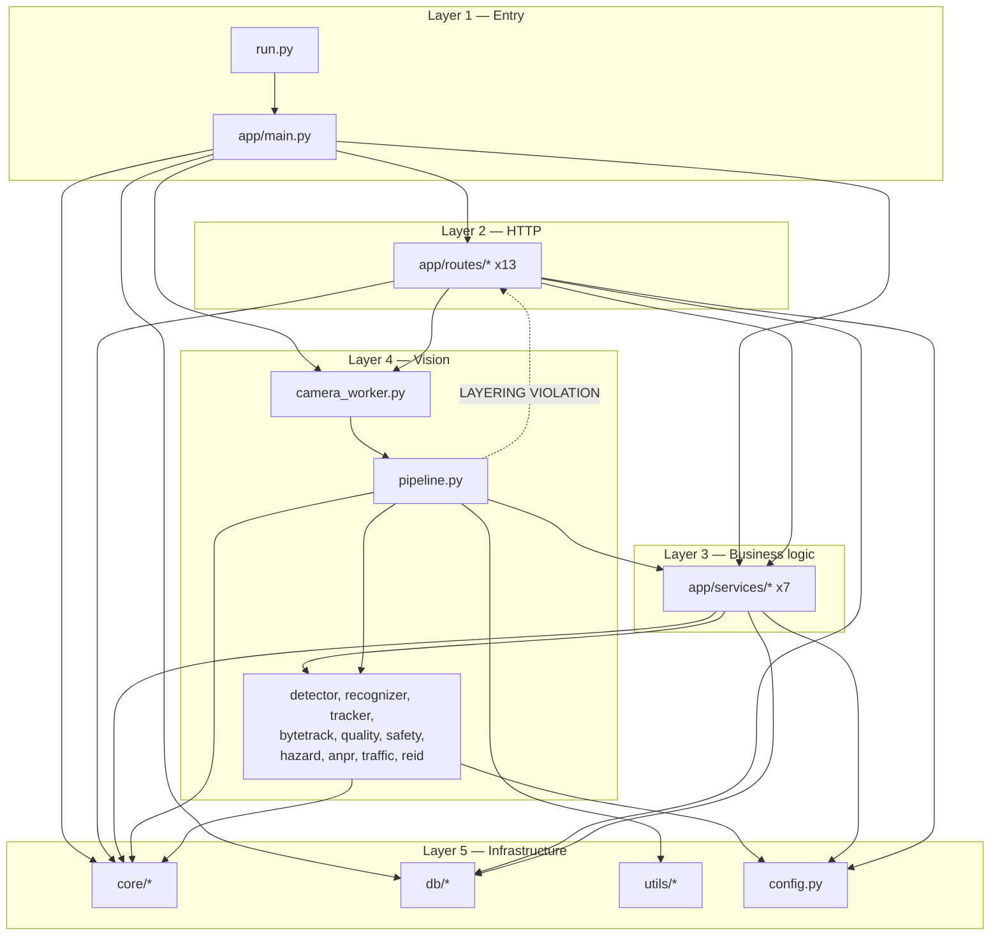

## 10.2 Circular dependencies

There are **four** cycles. All are resolved by deferring the import to function-call time
or to the bottom of the module — none currently break, but all are fragile.

### Cycle 1 — vision and services

```
pipeline.py --(function-level import)--> services/person_service.py
person_service.py --(module-level)--> vision/recognizer.py
```

`pipeline._auto_refresh_encodings()` does `from app.services.person_service import PersonService`
**inside the function body**. `person_service.py` imports `serialize_encoding` /
`deserialize_encoding` at module level. Deferring the import breaks the cycle at import time.

### Cycle 2 — vision to routes (a genuine layering violation)

```
pipeline.process_frame():
    from app.routes.browser_camera import _browser_sessions
```

The AI layer reads the HTTP layer's module-global session dictionary on every frame of a
browser camera. `routes/cameras.py` and `routes/events.py` in turn import
`camera_worker.camera_manager`, closing the loop. This is the worst structural coupling in
the codebase.

### Cycle 3 — search_backend and config

`search_backend.py` line 273 — **after** all class definitions:

```python
# Avoid circular import — import settings at module level
from app.config import settings
```

`create_search_backend()` (defined at line 249) references `settings` at call time, so the
bottom-of-file import works. Any reordering breaks it.

### Cycle 4 — services and services

`embedding_suggestions.approve_suggestion()` and `delete_encoding()` do
`from app.services.person_service import PersonService` inside the function, because
`person_service` is imported by the routes that also import `embedding_suggestions`.

## 10.3 Function-level (deferred) imports — a full inventory

Deferred imports are used roughly 40 times. They serve three distinct purposes; a
maintainer should know which is which before "cleaning them up":

| Purpose | Examples |
|---|---|
| **Break a cycle** | `pipeline -> person_service`, `pipeline -> routes.browser_camera`, `embedding_suggestions -> person_service` |
| **Defer an expensive import** | `from ultralytics import YOLO`, `import easyocr`, `from rfdetr import ...`, `from deepface import DeepFace`, `import torch` inside `_load_model` methods |
| **Habit / no clear reason** | `from app.utils.image_utils import resize_frame` inside `process_frame` (called every frame — a module-level import would be free) |

## 10.4 External dependency map

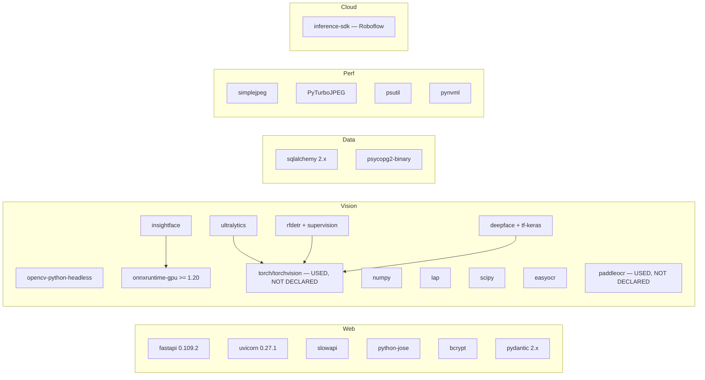

**Dependency risks I can state with certainty:**

1. `paddleocr` is the *primary* OCR engine (`_paddle_read`) but is absent from
   `requirements.txt`. A clean install silently degrades to EasyOCR-only, with a
   `logger.warning`.
2. `torch` and `torchvision` are absent, arriving only transitively. ReID
   (`torchvision.models.resnet50`) will break if a future ultralytics drops the dependency
   or pins an incompatible version.
3. `onnxruntime-gpu>=1.20` is pinned with a comment explaining that Blackwell (sm_120)
   needs it. This is a hard hardware requirement, not a preference.
4. The `rfdetr` import is wrapped in `try/except ImportError` everywhere, so its absence
   degrades gracefully to YOLOv8.

## 10.5 Frontend dependency graph

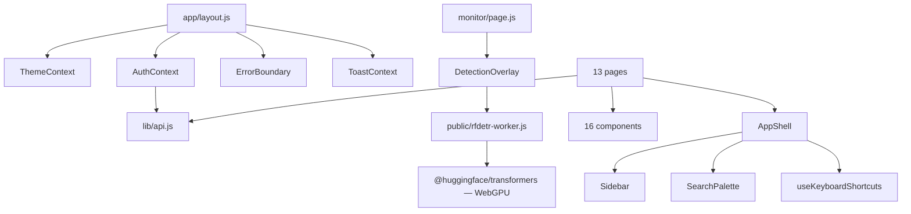

The frontend has **only 4 runtime dependencies** (`next`, `react`, `react-dom`,
`@huggingface/transformers`). No component library, no state manager, no chart library,
no CSS framework — charts, heatmaps, and rings are hand-drawn SVG.

---

# PHASE 11 — PERFORMANCE

## 11.1 The critical path

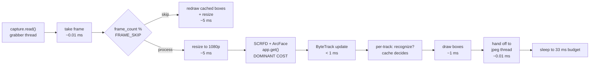

The single dominant cost is `app.get(frame)` — SCRFD detection plus ArcFace embedding for
every detected face, in one ONNX forward pass. Everything else in the loop is under ~10 ms
combined.

The profiler declares its expectations via `SLOW_THRESHOLDS`, which is the best available
statement of the intended budget:

| Stage | Warning threshold |
|---|---|
| `scrfd_inference` | 25 ms |
| `arcface` | 15 ms |
| `jpeg_encode` | 20 ms |
| `ws_send` | 20 ms |
| `frame_total` | 50 ms |

A 50 ms `frame_total` budget corresponds to 20 FPS, consistent with the 30 FPS target and
`FRAME_SKIP=3`.

## 11.2 GPU usage

| Consumer | Model | Framework | When loaded |
|---|---|---|---|
| Face detection + embedding | SCRFD-10G + ArcFace R50 (`buffalo_l`) | ONNX Runtime CUDA | First processed frame |
| Hazard detection | RF-DETR Large or YOLOv8n | PyTorch CUDA | First 30th frame |
| YOLO-assist | **shares the hazard model** when it is a YOLO backend | PyTorch CUDA | First assist trigger |
| Traffic | RF-DETR / YOLOv8 (or remote Roboflow) | PyTorch CUDA | First 5th frame |
| ANPR vehicle | YOLOv8m (hard-coded) | PyTorch CUDA | First ANPR frame |
| ANPR plate | custom YOLO — **file missing** | PyTorch CUDA | never (load fails) |
| OCR | PaddleOCR + EasyOCR | PyTorch CUDA | First OCR call |
| ReID | ResNet50 | PyTorch CUDA | First ReID call |
| Attributes | DeepFace | TensorFlow | First attribute call |

**VRAM-conscious design decisions I found:**
- `_get_insightface_app()` is a process-wide singleton — N cameras share one model.
- `_load_yolo_person_detector()` explicitly reuses `hazard_detector._model`, with the
  comment *"saves ~6MB GPU per camera"*.
- `ReIDFeatureExtractor` uses `__new__`-based singleton so one ResNet50 serves all cameras.
- ESRGAN / TrOCR / Qwen2-VL are disabled with documented VRAM costs (800 MB / 1 GB / 4 GB).

**Mixing ONNX Runtime and PyTorch in one process means two independent CUDA contexts**,
each with its own allocator. This roughly doubles the baseline VRAM overhead. I have not
measured it, but it is a structural consequence worth knowing.

The `detector.py` CUDA verification block exists precisely because ONNX Runtime fails
*silently* to CPU. The comment states the impact: *"turning 10 ms inference into
200-500 ms."*

## 11.3 CPU usage

Per-frame CPU work, in rough order of cost:

1. **JPEG encoding** — 5.4 ms (simplejpeg) to 19.1 ms (OpenCV) at 1080p, per the
   benchmark in the docstring. Moved off the critical path into its own thread.
2. **`resize_frame`** — one `cv2.resize` with `INTER_AREA` from full-res to 1080p.
3. **`frame.copy()`** — appears in `submit_frame` for hazard/traffic/ANPR (each copies the
   full frame), in `_process_frame_hybrid` (`clean_frame_for_face = frame.copy()`), and in
   `_process_frame_traffic_logic` (`clean_frame = frame.copy()`). At 4 MP BGR that is
   ~11.7 MB per copy.
4. **Unknown-face crops** — three `.copy()` calls per new unknown, deliberately done on the
   vision thread with the comment *"These copies are fast (~0.5ms each) vs save_snapshot
   (~10-30ms each)"* — the cheap part stays, the expensive part is queued.
5. **SCRFD post-processing** — bbox extraction, geometry validation.
6. **ByteTrack** — vectorised NumPy IoU + Hungarian assignment; negligible at typical face
   counts.

The FACE-mode path deliberately avoids an eager copy: `clean_frame = frame` is an alias,
with the comment explaining that eagerly copying a 4 MP frame *"wastes ~22 MB of memory
bandwidth per frame."*

## 11.4 Threading and async

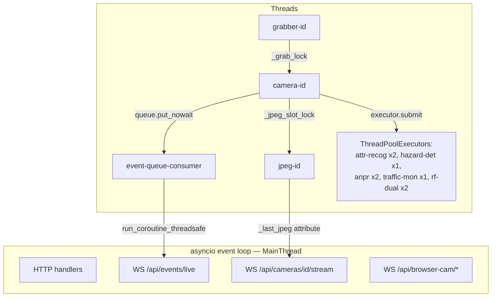

**The one async/sync bridge** is
`asyncio.run_coroutine_threadsafe(_broadcast_event(event), _main_loop)` in
`_process_pipeline_event`. `_main_loop` is captured in `lifespan` as a module global.

**Synchronisation primitives used:**

| Primitive | Where | Protects |
|---|---|---|
| `threading.Lock` | `_grab_lock` | `_grabbed_frame` |
| `threading.Lock` | `_jpeg_slot_lock` | `_jpeg_slot_frame` |
| `threading.Event` | `_jpeg_slot_event`, `_stop_event`, `_grabber_stop` | signalling |
| `threading.RLock` | `FaceRecognizer._lock`, `PersonTracker._lock`, `ReIDTracker._lock` | re-entrant state |
| `threading.Lock` | `EventQueue._lock`, `_person_ids_lock` | counters, ID set |
| `threading.Lock` | `_cooldown_lock`, `_counter_lock`, `_detections_lock`, `_model_lock`, `_track_lock` | module state |
| `asyncio.Lock` | `ConnectionManager._lock` | WS connection lists |
| `queue.Queue` | `EventQueue._queue` | the only real queue |

**Unprotected shared state I identified:**
- `pipeline._last_jpeg` — written by the JPEG thread, read by WS coroutines with no lock.
  Safe in CPython only because `bytes` assignment is atomic under the GIL.
- `traffic_monitor._known_face_zones` — written by the camera thread, read by the traffic
  worker thread. No lock.
- `pipeline._unknown_cache` — written by the camera thread; read by nothing else, so
  currently safe.

## 11.5 Queues and backpressure

| Mechanism | Type | Overflow behaviour |
|---|---|---|
| Frame grabber | 1-slot, overwrite | Old frames dropped — **desired**, keeps latency bounded |
| JPEG handoff | 1-slot, overwrite | Old frames dropped — **desired** |
| `EventQueue` | `queue.Queue(500)` | NORMAL dropped with a warning; CRITICAL retries 1 s then runs synchronously |
| `ThreadPoolExecutor` | unbounded internal queue | **No backpressure** |

> **The unbounded executor queues are the real backpressure risk.** `HazardDetector`,
> `PlateRecognizer`, and `TrafficMonitor` all do
> `frame_copy = frame.copy(); executor.submit(...)`. If inference is slower than the
> submission rate — very plausible for Roboflow's ~750 ms round trip at
> `TRAFFIC_FRAME_INTERVAL=5` on a 30 FPS stream (a submission every ~167 ms) — the queue
> grows without bound, each entry holding a full-frame copy. At 11.7 MB per 4 MP frame,
> this becomes an out-of-memory condition rather than a slowdown.
>
> Frame-interval throttling is the only defence, and it is open-loop: it does not observe
> whether the worker is keeping up.

## 11.6 Memory

**Per-frame transient:** roughly 6.2 MB at 1080p after the resize optimisation (down from
11.7 MB, per the code comment).

**Per-camera steady state:** the pipeline object, `_last_frame`, `_last_jpeg`,
`_last_face_draws`, plus a full copy of the normalised embedding matrix
(~1 MB at 500 encodings).

**Unbounded growth — confirmed by reading the code:**

| Structure | Location | Pruning | Impact |
|---|---|---|---|
| `VisionPipeline._unknown_cache` | pipeline | **none** | Grows for every distinct unknown face for the camera's whole lifetime. Each entry holds a 512-float embedding plus metadata. Worse: `_handle_unknown_face` does a **linear scan of the entire dict** for every unknown face, so processing cost grows linearly too. |
| `AttributeRecognizer._processed_tracks` / `_results` | safety_analytics | **none** | One entry per person ID ever seen |
| `PlateRecognizer._plate_cooldowns` | anpr | **none** | One entry per distinct plate ever read |
| `PersonTracker._cooldowns` | tracker | on hit only | Entries for people who never return persist |
| `VideoAnalysisManager._jobs` | video_analysis | manual delete only | Each holds a full result set |
| `ReIDTracker._last_sighting` | reid | **none** | One entry per (reid_id, camera) pair |

Structures that *are* bounded: `ByteTracker._removed_stracks` (1000/500),
`VehicleByteTracker._removed` (500/250), `ReIDTracker._gallery` (LRU at 500),
`ReIDIdentity.sightings` (100), `TrackState.centroid_history` (deque 600),
`LoiteringTrack.history` (deque 600), `_yolo_body_unknown_cache` (60 s TTL),
`CrowdDetector._gatherings` (5 s expiry), `LoiteringDetector._tracks` (60 s prune).

**Snapshot disk growth:** three JPEGs per new unknown face (face ~q95, context ~q95, full
frame ~q90), never rotated. The retention API can delete DB rows but **never deletes files
from disk** — I verified `routes/retention.py` touches only `DetectionEvent` and
`UnknownFace` rows. Snapshots accumulate indefinitely.

## 11.7 Bottlenecks, ranked

| # | Bottleneck | Evidence | Mitigation present |
|---|---|---|---|
| 1 | SCRFD+ArcFace inference | Sole `scrfd_inference` timing; 25 ms threshold | `FRAME_SKIP=3`, recognition cache, GPU |
| 2 | Roboflow HTTP round-trip | ~750 ms parallel, ~1.5 s sequential (code comment) | Parallel calls, 640 px downscale, JPEG-70 |
| 3 | OCR | PaddleOCR + EasyOCR both run per plate | Keyframe gating claims ~80 % reduction |
| 4 | JPEG encoding | 5.4–19.1 ms benchmarked | Dedicated thread + simplejpeg |
| 5 | Snapshot disk I/O | ~10–30 ms per `save_snapshot`, 3 per unknown | Moved to the event-queue thread |
| 6 | Unknown-face DB dedup | Full table scan + Python loop per unknown | **none** |
| 7 | `_unknown_cache` linear scan | O(n) per unknown, n never shrinks | **none** |
| 8 | Per-frame `frame.copy()` | Up to 4 copies/frame in hybrid mode | FACE mode aliases instead |
| 9 | Single uvicorn worker | Hard requirement from in-memory state | none possible without a redesign |
| 10 | DeepFace (TensorFlow) | Loads a whole second DL framework | Once per track only, 2-thread pool |

## 11.8 Profiling hooks

The profiler is genuinely well built. Instrumentation points:

**Context-manager timings:** `frame_total`, `scrfd_inference`, `scrfd_postprocess`,
`bytetrack`, `arcface`, `drawing`, `jpeg_encode`, `queue_put`.
(`scrfd_preprocess` and `matching` are referenced in the report builder but never
recorded — the preprocess stage was removed when the `cvtColor` was deleted.)

**Counters:** frames received/skipped/dropped, detection frames, faces detected, tracks
seen, recognition calls, cache hits, tracks recreated, forced rechecks, cache reasons
(4 codes), carry-over success/failure, event-queue processed/dropped/wait-times, snapshots
saved with timings, DB inserts with timings and failures, WebSocket frame sizes, raw frame
sizes for the compression ratio, slow warnings.

**Report cadence:** every 100 total frames via `tick_frame()` in `CameraWorker._run_loop`.
Written to the log **and** appended to `logs/performance.log`.

**Percentage calculation is done correctly** — `sum(stage_times) / sum(frame_total_times)`
rather than `mean/mean`, which matters because stages have different sample counts
(`arcface` runs far less often than `frame_total`).

**Known inaccuracies in `print_startup_summary()`** — it hard-codes three values that
contradict the running configuration:

```
JPEG Quality     : 65        # actual default is 80 (only 65 under Tier-2 load)
Stream Resolution: 960x540   # actual is 1920x1080
```

These are stale strings, not computed values. A maintainer reading the startup banner will
be misled.

---

# PHASE 12 — DESIGN DECISIONS

## 12.1 Decisions that are well justified

### Threaded frame grabber
**Problem:** OpenCV buffers frames; DSHOW ignores `CAP_PROP_BUFFERSIZE=1`; slow processing
produces stale frames and visible "jumps".
**Solution:** a dedicated thread that reads continuously and keeps only the latest frame.
**Trade-off:** deliberately drops frames. Correct for live monitoring, wrong for forensic
recording — the system is not a DVR and does not claim to be.

### Async event queue
**Problem:** DB writes + snapshot I/O cost 50–170 ms per detection frame on the vision
thread.
**Solution:** fire-and-forget queue with a dedicated consumer.
**Trade-off:** events are eventually consistent; NORMAL events can be dropped under load.
The priority split ensures the *audit trail* (entry/exit/alerts) is never lost while
*enrichment* (unknown snapshots) is sacrificial. This is the right priority ordering.

### JPEG encoding on a separate thread with a 1-slot handoff
**Problem:** `imencode` costs ~19 ms on the critical path.
**Solution:** single-slot latest-wins exchange.
**Trade-off:** the stream may skip frames under load, which is invisible to a human viewer.
Choosing a slot over a FIFO is the key insight — a queue would accumulate latency.

### Time-based recognition cache
**Problem:** ArcFace on every face every frame saturates the GPU.
**Solution:** lock confident identities, re-check on a wall-clock schedule.
**Why wall-clock and not frame counts:** behaviour stays identical across cameras running
at different frame rates. This is explicitly documented as "FPS-independent".

### Hysteresis + gray zone + temporal rescue
**Problem:** ArcFace distance oscillates around the threshold, causing visible
Known→Unknown→Known flicker and spurious duplicate entry events.
**Solution:** three layered defences (Phase 5.7).
**Trade-off:** identity is sticky — a genuine identity change is detected up to 5 frames
late. Given the failure mode being fixed, correct.

### Identity carry-over in ByteTrack
**Problem:** a brief occlusion creates a new track, which is unrecognised, which creates a
duplicate unknown and a duplicate entry event.
**Solution:** inherit identity from a recently-lost track with IoU > 0.3.
**Trade-off:** if two people cross paths, the wrong identity can be inherited. Mitigated by
the fact that new tracks have `tracklet_len < 3` and are therefore always re-recognised.

### Split detect/recognise size gates
**Rationale, quoted from the config:** *"never guess on insufficient pixels."*
32 px faces are useful for counting and tracking; 80 px is the floor for identification.
This is a principled separation that many systems get wrong.

### Pure-ASGI middleware
Documented with a link to `starlette#1600`. `BaseHTTPMiddleware` wraps responses in
`StreamingResponse` and strips headers set by outer middleware, silently breaking CORS.
This is a real, non-obvious Starlette bug and the workaround is correct.

### CORS added last
Starlette applies middleware LIFO, so the last-added runs first. CORS must intercept
`OPTIONS` preflight before anything else. The comment says exactly this.

### Disabling heavy OCR models
ESRGAN (200–500 ms, 800 MB), TrOCR (500 ms, 1 GB), Qwen2-VL (2–3 s, 4 GB) were measured
and disabled behind a flag, replaced by a ~5 ms OpenCV CLAHE/bilateral/unsharp chain. The
code paths remain for offline use. This is exactly the right way to retire an experiment.

## 12.2 Assumptions baked into the design

| Assumption | Where it binds | What breaks if false |
|---|---|---|
| Single process, single worker | all module-global singletons | Horizontal scaling is impossible without a redesign |
| Gallery fits in RAM | `NumpySearchBackend` full matrix per pipeline | Above ~2 k encodings, search becomes the bottleneck |
| Few hundred enrolled people | O(N) linear scan per query | Same |
| One NVIDIA GPU at index 0 | `CUDA_VISIBLE_DEVICES=0`, `ctx_id=0` | Multi-GPU unusable |
| Plates are Indian | 36-code whitelist, format regexes, correction tables | Non-Indian plates are rejected outright by `_fix_indian_plate` |
| Cameras are trusted | no auth on browser-cam ingest | Anyone can inject frames |
| Snapshots are not sensitive | `/snapshots` served unauthenticated | PII exposure (Phase 13) |
| PostgreSQL is always reachable | hard startup dependency, per-call sessions | Startup aborts; runtime writes are logged and dropped |
| Frames may be dropped freely | grabber + JPEG slot | Not usable as evidentiary recording |

## 12.3 Limitations

1. **No horizontal scaling.** Single worker enforced by design.
2. **No persistence of live tracking state.** A restart loses occupancy and leaves
   `tracking_sessions` rows permanently `active`.
3. **No video recording.** Only snapshots. There is no clip retrieval for an incident.
4. **`vehicle_count` events are not persisted** — no historical traffic volume.
5. **Unknown clustering is not implemented** — `cluster_id` is a column with an index and
   no writer.
6. **Encoding health tracking is not implemented** — `usage_count`/`success_count`/
   `last_matched` are never written, so smart replacement degenerates to quality ranking.
7. **Video analysis results are memory-only** — lost on restart.
8. **No test suite, no CI.**
9. **No Alembic** — schema evolution is manual.
10. **Attributes are gender + shirt colour only**, and gender inference from CCTV is both
    low-accuracy and ethically fraught.
11. **ReID is unreachable in the deployed mode.**
12. **The plate and traffic model files are absent from the repository**, so ANPR cannot
    localise plates as configured.

## 12.4 Extension points that already exist

| Point | Mechanism | Effort |
|---|---|---|
| Swap similarity search | `SearchBackend` ABC — implement `FAISSSearchBackend`, set `SEARCH_BACKEND=faiss` | Low; the factory already branches |
| New security analytic | Implement a class with `update()` + `on_alert` callback, wire into `_run_safety_analytics` | Low |
| New pipeline mode | Add a `_process_frame_<mode>` and a branch in `process_frame` | Medium |
| New event type | Add to the pipeline's emit, extend `_process_pipeline_event` | Low |
| New detector backend | Follow the `_load_model()` try/except-ImportError cascade pattern | Low |
| New OCR engine | Add a `_x_read()` and extend the voting in `_ocr_region` | Low |
| TensorRT acceleration | `VehiclePlateDetector.export_to_tensorrt()` already exists, and loaders check for a sibling `.engine` file | Low — but the class has no callers |

## 12.5 Technical debt register

| # | Debt | Severity | Evidence |
|---|---|---|---|
| 1 | `_yolo_assist_interval` AttributeError breaks hybrid mode | **Critical** | `pipeline.py:1849`; attribute never assigned |
| 2 | `gate.assess()` missing `face_location` kills the suggestion feature | **High** | `pipeline.py:1045` vs `quality.py:60` |
| 3 | Adaptive thresholds unreachable | **High** | all 4 call sites omit `face_quality` |
| 4 | `_unknown_cache` never pruned — memory + O(n) scan | **High** | no deletion anywhere in `pipeline.py` |
| 5 | Unbounded executor queues holding frame copies | **High** | `submit_frame` in 3 modules |
| 6 | `pipeline` imports from `routes` | **High** | layering violation, cycle 2 |
| 7 | No Alembic; ORM and SQL migrations disagree | **High** | Phase 8.3 |
| 8 | Snapshots never deleted by retention | **Medium** | `retention.py` touches only DB rows |
| 9 | `VisionPipeline` is a 1,948-line god object | **Medium** | 3 near-duplicate frame processors |
| 10 | Legacy + new vehicle trackers coexist in ANPR | **Medium** | `_tracked_vehicles` alongside `VehicleByteTracker` |
| 11 | `cluster_id`, `usage_count`, `success_count`, `last_matched`, `encoding_versions` are write-only or read-only stubs | **Medium** | verified by grep |
| 12 | Mojibake in `pipeline.py` comments | **Low** | UTF-8 box-drawing written as cp1252 |
| 13 | `mock_store.py`, `benchmarks.py`, `VehiclePlateDetector` are dead | **Low** | zero importers |
| 14 | Debug artifacts + model weights committed to git | **Low** | `debug_crops/`, `debug_crops2/`, `runs/`, `*.pt` |
| 15 | Dockerfile installs dlib deps, uses a non-CUDA base | **Low** | migrated away from dlib |
| 16 | `next.config.mjs` hard-codes `localhost:8000` | **Medium** | breaks Docker networking |
| 17 | Startup banner prints wrong JPEG quality and resolution | **Low** | hard-coded strings |
| 18 | ReID docstrings say 512-d, code produces 2048-d | **Low** | stale after a deliberate change |

---

# PHASE 13 — SECURITY REVIEW

Assessed against OWASP API Security Top 10 (2023).

## 13.1 Authentication

**Mechanism:** JWT bearer tokens, HS256, 60-minute expiry, bcrypt password hashing
(with correct 72-byte truncation). Login is rate-limited to 5/minute per IP via slowapi.
`AuthService.login` returns the identical `NotFoundException` for both unknown email and
wrong password, correctly preventing user enumeration.

**Findings:**

| ID | Severity | Finding |
|---|---|---|
| A1 | **Critical** | `backend/.env` contains `JWT_SECRET_KEY=your-super-secret-jwt-key-change-this` — the literal placeholder from `.env.example`. Anyone with access to the public example file can forge a valid superadmin token for this deployment. |
| A2 | **Critical** | `create_default_admin()` runs on **every startup** and creates `admin@cctv.local` / `admin123` whenever the `admin_users` table is empty. The credentials are printed to the log. There is no forced password change. |
| A3 | **High** | `JWT_SECRET_KEY` defaults to `""`. A deployment without `.env` signs tokens with an empty key. |
| A4 | **Medium** | No token revocation. `POST /api/auth/logout` returns a message and does nothing server-side. A stolen token is valid for its full lifetime. |
| A5 | **Medium** | `/api/auth/refresh` issues a new token from a valid one with no rotation or reuse detection, giving indefinite session extension. |
| A6 | **Low** | Password minimum length is 6 on login (`LoginRequest`) but 8 on registration (`AdminUserCreate`) — inconsistent, and both are weak. |

## 13.2 Authorization — **the weakest area**

Only two levels exist: authenticated (`get_current_user`) and admin (`require_admin`).
`require_admin` is applied to exactly six endpoints: register, unknown-face
enroll/merge/dismiss, and retention cleanup. Everything else accepts any valid token,
including the `operator` role.

| ID | Severity | Finding |
|---|---|---|
| Z1 | **Critical** | `GET /api/cameras/{camera_id}/feed` has **no authentication at all** and sets `Access-Control-Allow-Origin: *`. Anyone who can reach the port and guess or enumerate a camera ID gets the live annotated video feed, cross-origin, from any website. |
| Z2 | **Critical** | `WS /api/browser-cam/stream/{session_id}` has **no authentication**. An attacker can (a) inject arbitrary frames into the AI pipeline, poisoning the event log with fabricated detections, and (b) auto-start a full `VisionPipeline` per connection — a direct resource-exhaustion vector bounded only by `MAX_CAMERAS=10`. |
| Z3 | **High** | `WS /api/cameras/{id}/stream` and `WS /api/events/live` accept a `?token=` parameter but only validate it **if present**. No token means the connection is accepted. Live video and the full real-time event stream are effectively public. The frontend does not send a token, so this is not merely theoretical — it is the normal path. |
| Z4 | **High** | `GET /api/browser-cam/feed/{id}`, `WS /api/browser-cam/view/{id}`, and `GET /api/browser-cam/sessions` are unauthenticated. The last enumerates all active session IDs, which is exactly what Z1/Z3 need. |
| Z5 | **High** | The `/snapshots` static mount is unauthenticated. It contains face crops, context crops, and full frames of every unknown person — biometric PII — served to anyone. |
| Z6 | **Medium** | An `operator` can create/delete persons and cameras, start/stop pipelines, export all data, and read every event. No object-level authorization exists anywhere (BOLA — OWASP API1). |
| Z7 | **Medium** | `GET /api/cameras/debug/recognition-state` exposes all enrolled person IDs and names to any authenticated user. |
| Z8 | **Low** | `GET /share-camera` is unauthenticated; it is a page, not data, but it advertises the ingest endpoint. |

## 13.3 Input validation

**Good:** `models/camera.py` is genuinely defensive — `stream_url` is whitelisted against
four regex patterns and rejected if it contains `; | & \` $ ( ) { } \n \r`; `name` and
`location` strip `< > & ' " \`. This blocks command injection into `cv2.VideoCapture` and
stored XSS. Pagination is bounded (`ge`/`le` on `limit`/`offset`) on every list endpoint.

| ID | Severity | Finding |
|---|---|---|
| V1 | **Medium** | Date parameters (`start_date`, `end_date`) are accepted as free strings and passed to SQLAlchemy comparisons. Parameterisation prevents injection, but a malformed value produces a 500 from the driver rather than a 422. |
| V2 | **Low** | Image upload validates only `file.content_type`, which is client-supplied. Mitigated in practice: the bytes go straight to `cv2.imdecode`, which returns `None` for non-images and triggers a clean 422. |
| V3 | **Low** | `Person.email` uses `Optional[str]`, not `EmailStr`, so no format validation. |
| V4 | **Low** | `search.py` builds `ilike(f"%{query}%")` — safely parameterised, but unescaped `%` and `_` let a caller force a full-table scan. |

## 13.4 File uploads

**Video upload is handled well:** extension whitelist, 1 MB streaming chunks, size checked
during the write with cleanup on overflow, and — importantly — the file is saved as
`{uuid4}.{ext}`, so the user-controlled filename never reaches the filesystem path. Path
traversal is structurally impossible.

| ID | Severity | Finding |
|---|---|---|
| F1 | **Medium** | No content inspection — any file with an allowed extension is written to disk, then handed to `cv2.VideoCapture`. This is a large parsing surface (FFmpeg) exposed to arbitrary bytes. |
| F2 | **Low** | Uploaded videos are deleted only via `DELETE /{job_id}`. Abandoned jobs leave files forever (up to 2 GB each). |
| F3 | **Low** | Snapshot filenames embed server-generated UUIDs — safe — but `save_snapshot` writes relative to the CWD rather than `settings.SNAPSHOT_DIR`, so changing that setting silently breaks the mapping between stored URLs and served files. |

## 13.5 Database

| ID | Severity | Finding |
|---|---|---|
| D1 | **High** | `deserialize_encoding()` falls back to `pickle.loads(data)` for any blob that is not exactly 2048 bytes. `pickle.loads` on untrusted input is **arbitrary code execution**. The input is the database, so this requires prior DB compromise — but it converts a read-only DB compromise into full RCE in the application process. Given migration 003 states no legacy pickle rows need conversion, this fallback should simply be deleted. |
| D2 | **Medium** | `.env` ships `DB_PASSWORD=postgres` with `DB_USER=postgres` — default superuser credentials. |
| D3 | **Medium** | No connection encryption is configured (no `sslmode` in the URL). |
| D4 | **Low** | The application connects as a superuser; no least-privilege role exists. |

**SQL injection:** I found none. Every query uses the SQLAlchemy ORM with bound
parameters. There is no raw SQL string construction anywhere in the application code.

## 13.6 API and transport

| ID | Severity | Finding |
|---|---|---|
| T1 | **High** | No HTTPS enforcement, no HSTS. JWTs travel in plaintext over HTTP by default. |
| T2 | **Medium** | Rate limiting exists **only** on `/api/auth/login`. Every other endpoint — including the expensive `/api/analytics/export` (up to 10,000 rows) and `/api/video-analysis/upload` (2 GB) — is unlimited. |
| T3 | **Medium** | No security headers: no CSP, `X-Frame-Options`, `X-Content-Type-Options`, or `Referrer-Policy`. |
| T4 | **Low** | The global exception handler returns `{"detail": "Internal server error", "type": type(exc).__name__}` — the exception class name is a minor information leak. |
| T5 | **Low** | `DEBUG=True` by default enables uvicorn auto-reload; `/docs` and `/redoc` are always exposed with no auth. |
| T6 | **Low** | `allow_credentials=True` with an origin whitelist is correct, but the frontend uses `localStorage` bearer tokens, so credentials mode is unnecessary. `localStorage` is XSS-readable; `httpOnly` cookies would be stronger. |

## 13.7 Secrets and environment

| ID | Severity | Finding |
|---|---|---|
| S1 | **Critical** | `JWT_SECRET_KEY` is the placeholder value (A1). |
| S2 | **High** | `ROBOFLOW_API_KEY=your-roboflow-api-key-here` — the integration is enabled but cannot authenticate; calls fail and fall through to local models. Functionally broken rather than exploitable, but it indicates secrets were never provisioned. |
| S3 | **Medium** | `.env` is correctly `.gitignore`d and is **not** in git history — I verified this. But it sits unencrypted on disk with default credentials. |
| S4 | **Low** | `.env.example` publishes the exact placeholder strings that the live `.env` still uses, making A1 trivially exploitable by anyone reading the repository. |

## 13.8 Filesystem

| ID | Severity | Finding |
|---|---|---|
| P1 | **High** | `/snapshots` is a public static mount containing biometric PII (Z5). Under GDPR/DPDP this is personal data of identifiable individuals, published without access control. |
| P2 | **Medium** | Unbounded disk growth — snapshots are never deleted, and retention cleanup ignores the filesystem entirely. |
| P3 | **Low** | The Docker container runs as root and mounts `/dev/video0`. |

## 13.9 OWASP API Top 10 scorecard

| Risk | Status | Notes |
|---|---|---|
| API1 Broken Object Level Authorization | **FAIL** | No object-level checks; any user reaches any person/camera/event |
| API2 Broken Authentication | **FAIL** | Placeholder secret, default admin, no revocation |
| API3 Broken Object Property Level Authorization | **PARTIAL** | Pydantic response models exist but most endpoints return raw dicts, bypassing filtering |
| API4 Unrestricted Resource Consumption | **FAIL** | Rate limit on login only; 2 GB uploads; unbounded executor queues |
| API5 Broken Function Level Authorization | **FAIL** | Only 6 endpoints check for admin |
| API6 Unrestricted Access to Sensitive Business Flows | **FAIL** | Unauthenticated frame ingest can poison the audit log |
| API7 Server Side Request Forgery | **PASS** | `stream_url` is whitelisted; Roboflow URL is config-only |
| API8 Security Misconfiguration | **FAIL** | DEBUG on, no security headers, no TLS, `/docs` public |
| API9 Improper Inventory Management | **PARTIAL** | Good OpenAPI docs; but undocumented debug endpoints exist |
| API10 Unsafe Consumption of APIs | **PARTIAL** | Roboflow responses parsed with `.get()` defaults, wrapped in try/except |

## 13.10 Minimum viable hardening (in order)

1. Generate a real `JWT_SECRET_KEY` (`python -c "import secrets;print(secrets.token_urlsafe(64))"`) and **refuse to start** if it is empty or equals the placeholder.
2. Remove `create_default_admin()`, or force a password change on first login.
3. Require authentication on `/api/cameras/{id}/feed`, both stream WebSockets, and all
   `browser-cam` endpoints. Make the `?token=` check mandatory, not conditional.
4. Put `/snapshots` behind an authenticated route instead of `StaticFiles`.
5. Delete the `pickle.loads` fallback in `deserialize_encoding`.
6. Set `DEBUG=false`; disable `/docs` in production.
7. Terminate TLS in front of the app; add HSTS and basic security headers.
8. Add rate limits to upload, export, and search.
9. Create a least-privilege database role.

---

# PHASE 14 — CODE QUALITY

## 14.1 Dead code — verified by grep

| Item | File | Evidence |
|---|---|---|
| `MockStore` (317 lines) | `core/mock_store.py` | Self-documented as deprecated; zero importers |
| `PipelineBenchmark` / `pipeline_bench` | `vision/benchmarks.py` | Zero importers |
| `VehiclePlateDetector` (~490 lines) + `get_vehicle_plate_detector` | `vision/detector.py` | Zero call sites — `anpr.py` loads its own YOLO models. Includes the otherwise-useful `export_to_tensorrt()` and `associate_plates_to_vehicles()` |
| `handle_frame()` | `main.py:68` | Body is `pass`; the entire `on_frame` callback chain through `CameraManager` → `CameraWorker` → `VisionPipeline` is inert |
| `FaceRecognizer.recognize_faces_batch` | `recognizer.py:449` | Zero call sites; also the only path that would exercise `face_quality` |
| `NumpySearchBackend.search_batch` | `search_backend.py:211` | Zero call sites |
| `SearchBackend.remove_person` | `search_backend.py` | Never called — `remove_person_encodings` rebuilds the whole index instead |
| `ConnectionManager.connect_stream` / `disconnect_stream` / `send_frame` / `stream_counts` | `core/websocket.py` | The stream route polls `_last_jpeg` directly |
| `FaceDetector.detect_faces_raw`, `assess_face_quality`, `location_to_xyxy`, `xyxy_to_location` | `vision/detector.py` | No call sites in `app/` |
| `PlateRecognizer._trocr_read`, `_qwen_read_plate`, ESRGAN block | `vision/anpr.py` | Behind `_disable_heavy_models = True` |
| `get_db()` | `db/session.py` | Zero routes use the dependency |
| `utils/time_utils.py` (most of it) | | Modules call `datetime.now(timezone.utc)` inline |
| `app/migrations/001` and `002` | | Superseded by `create_all`; describe a Supabase schema that no longer matches |

## 14.2 Duplicate logic

**IoU is implemented six times:**

| Implementation | File | Form |
|---|---|---|
| `_iou_batch` | `bytetrack.py:123` | vectorised (N,M) |
| inline loop | `pipeline.py:503-511` | scalar, in `process_frame` |
| `_box_iou` | `anpr.py:1009` | scalar static |
| `_bbox_iou` | `traffic.py:1084` | scalar static, dict input |
| `_compute_bbox_iou` | `video_analysis_service.py:755` | scalar static |
| inline | `recognizer.py:580-591` | scalar, in `batch_generate_encodings` |

Plus two overlap variants: `_face_overlaps_person` (pipeline) and the person-filter loops
inside `traffic._analyze_roboflow`.

**Other duplication:**
- `_event_to_dict` defined three times: `routes/events.py:19`,
  `services/analytics_service.py:20`, `services/movement_service.py:22` — near-identical.
- `connectLiveEvents` defined **twice** in `frontend/src/lib/api.js` (lines 275 and 319);
  the second silently shadows the first.
- Streaming scale-factor initialisation duplicated verbatim in `process_frame` and
  `_process_frame_hybrid`.
- Face recognition + tracking loop duplicated between `process_frame` (with ByteTrack and
  the full cache) and `_process_frame_hybrid` (without either).
- Two vehicle trackers coexist in `PlateRecognizer`: `VehicleByteTracker` plus the legacy
  `_tracked_vehicles` / `_match_track` / `_add_vote` path. Votes are fed to **both**.
- `AnalyticsService.get_movement_logs` and `MovementService.list_movements` query the same
  table with the same filters.
- HSV colour-range tables duplicated between `safety_analytics._COLOR_RANGES` (11 entries)
  and `traffic.COLOR_RANGES` (7 entries).

## 14.3 Large functions

| Function | Lines | File |
|---|---|---|
| `VideoAnalysisJob._run_analysis` | ~470 | `video_analysis_service.py:163` |
| `VisionPipeline.process_frame` | ~410 | `pipeline.py:353` |
| `TrafficMonitor._analyze_roboflow` | ~290 | `traffic.py:338` |
| `PlateRecognizer._process` | ~190 | `anpr.py:773` |
| `VisionPipeline._process_frame_hybrid` | ~190 | `pipeline.py:1683` |
| `PerformanceProfiler._print_report` | ~270 | `profiler.py:443` |
| `_fix_indian_plate` | ~150 | `anpr.py:216` |
| `ByteTracker.update` | ~250 | `bytetrack.py:253` |
| `_process_unknown_face` | ~170 | `main.py:232` |

`process_frame` has a cyclomatic complexity I would estimate above 40 (nested loops with
6+ branch points per track). It is the highest-risk function to modify in the codebase.

## 14.4 High coupling

1. **`pipeline.py` imports 10 vision modules + 2 services + 1 route module.** It is the
   hub through which everything connects.
2. **`camera_manager._workers` is read directly** by `routes/cameras.py`,
   `routes/events.py`, `services/analytics_service.py`, and `main.py` — a private attribute
   treated as public API in four places.
3. **Cross-module private access:** `pipeline` writes `traffic_monitor._known_face_zones`
   and reads `traffic_monitor._last_detections` under `traffic_monitor._detections_lock`;
   `_load_yolo_person_detector` reaches into `hazard_detector._model`,
   `._model_available`, `._model_backend`.
4. **`main.py` reaches into pipeline internals** — `worker.pipeline.tracker.set_session_id`
   inside the DB persistence function.
5. **Routes reach into `pipeline._last_jpeg`** directly.

## 14.5 Poor abstractions

- **`VisionPipeline` is a god object.** Frame acquisition, mode dispatch, detection,
  tracking, recognition, hysteresis, drawing, scaling, unknown handling, YOLO-assist,
  load degradation, suggestions, encoding refresh, and traffic orchestration in one class.
  Three near-duplicate frame processors instead of a strategy per mode.
- **Services are namespaces, not objects.** All-static classes that each open their own
  session. No unit of work, no dependency injection, no transaction spanning operations.
- **`SearchBackend` is an abstraction with one implementation** and a stub that logs a
  warning. Reasonable forward planning, but currently overhead.
- **Callback chains obscure control flow.** `PersonTracker.on_entry` → `pipeline._handle_entry_event`
  → `pipeline.on_event` → `main.handle_pipeline_event` → `EventQueue.put` →
  `main._process_pipeline_event`. Five hops, three thread boundaries, no type contract.
- **`(top, right, bottom, left)` vs `(x1,y1,x2,y2)`** conversions scattered across the
  codebase, a legacy of the `face_recognition` migration.

## 14.6 Code smells

| Smell | Instances |
|---|---|
| Broad `except Exception: pass` / `logger.debug` | ~35 occurrences. **This is how both confirmed defects stayed hidden.** |
| Magic numbers | `DEDUP_DISTANCE = 200`, `0.3` IoU, `500` px, `0.45` det score, `0.7` similarity, `60` s TTLs — mostly not in config |
| Mojibake | `pipeline.py` comments contain `→` etc. — UTF-8 box-drawing written as cp1252 |
| Inconsistent naming | `metadata` vs `metadata_json`; `encoding` vs `encoding_data`; `models/` vs `db/models.py` |
| Unused imports | `asyncio` and `uuid4` in `camera_worker.py`; `shutil` in `video_analysis.py`; `joinedload` in `search.py` |
| Commented-out / stale docs | ReID says 512-d, produces 2048-d; ANPR docstring says "Real-ESRGAN 4x" for a disabled path |
| Hard-coded paths | `seed_teachers.py` falls back to `r"c:\Users\chira\Downloads\..."` |
| Hard-coded model | `_load_vehicle_model` uses `YOLO("yolov8m.pt")`, ignoring `ANPR_VEHICLE_MODEL` |
| Committed binaries | `yolo11m.pt`, `yolov8n.pt`, ~120 debug JPEGs, `runs/detect/` |
| `response_model` declared but unused | List endpoints return raw dicts, so schema filtering never applies |
| Unused exception variables | `except Exception as e: db.rollback(); raise` in several services |

## 14.7 What is genuinely good

It would be unbalanced not to record this. The following are above the standard I would
expect for a project of this size:

- **Comments explain *why*, with numbers.** "saves ~13 ms/frame", "3.5× faster",
  "~28 ms saved per frame", "reduces per-frame memory from 11.7 MB to 6.2 MB",
  "cuts latency from ~1.5 s to ~750 ms". These are measurements, not guesses.
- **The profiler** is a genuinely well-designed instrumentation system, and it computes
  percentages correctly (sum/sum, not mean/mean).
- **The carry-over failure diagnostics** classify failure modes and dump the candidate pool
  — someone debugged this properly instead of guessing.
- **Graceful degradation everywhere.** Every optional model is behind
  `try/except ImportError` with a documented fallback chain.
- **The colour-space bug** was found, fixed, documented in a comment repeated at all four
  call sites, and given a migration with a rollback plan.
- **The CUDA verification banner** turns a silent 20× slowdown into a loud error.
- **`models/camera.py`** is properly defensive input validation.
- **The middleware comment** citing `starlette#1600` shows real understanding of a subtle
  framework bug.
- **The ANPR Indian-plate correction tables** encode substantial domain knowledge that
  would be expensive to rediscover.

---

# PHASE 15 — IMPROVEMENT PLAN

## 15.1 Priority matrix

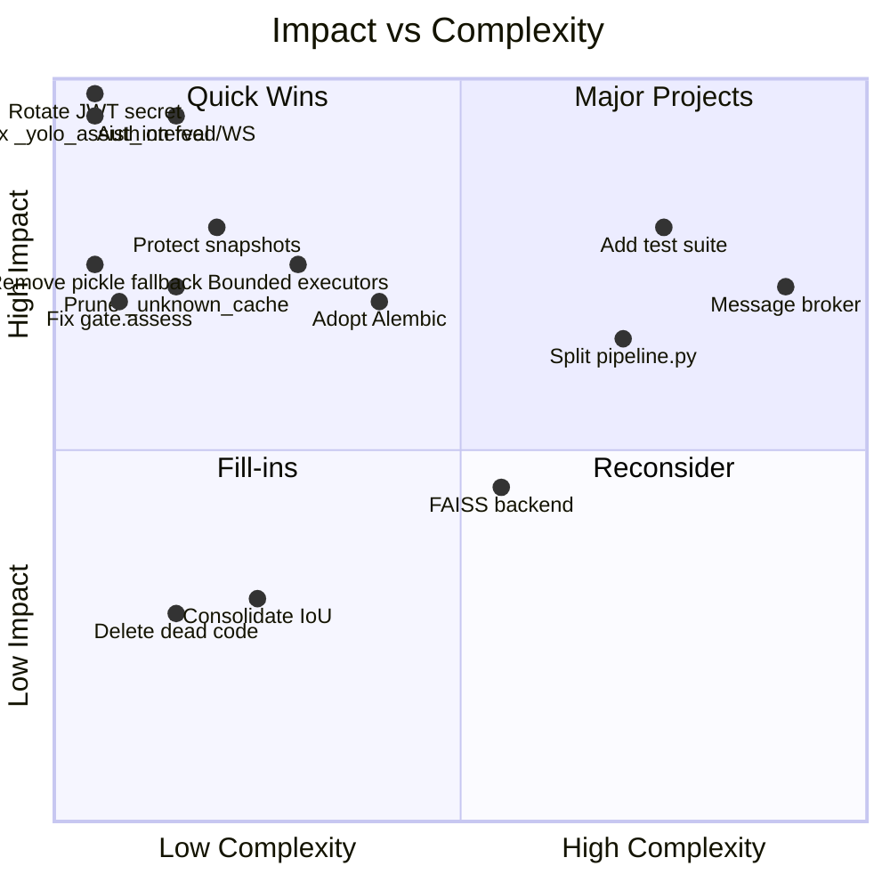

---

## 15.2 Tier 0 — Correctness and security (do these first)

### 0.1 — Fix the hybrid-mode crash
- **Change:** `pipeline.py:1849`, rename `self._yolo_assist_interval` →
  `self._yolo_assist_min_interval`.
- **Benefit:** hybrid mode becomes usable at all. Currently it collapses to ~1 FPS with a
  continuous error log whenever a face is present.
- **Complexity:** trivial — one identifier.
- **Risk:** none. The attribute currently does not exist, so no behaviour can depend on it.
- **Verification:** set `PIPELINE_MODE=hybrid`, start a camera, confirm no `AttributeError`
  in the log and that FPS is comparable to face mode.

### 0.2 — Rotate the JWT secret and fail closed
- **Change:** generate a real secret; add a startup assertion that rejects an empty or
  placeholder `JWT_SECRET_KEY`.
- **Benefit:** closes token forgery. This is the single highest-severity issue in the
  system — the current secret is published in `.env.example`.
- **Complexity:** trivial.
- **Risk:** all existing sessions are invalidated (acceptable, and desirable here).

### 0.3 — Remove the default admin
- **Change:** delete `create_default_admin()` or require a first-login password change.
- **Benefit:** removes `admin123` as a guaranteed working credential on every deployment.
- **Complexity:** low.
- **Risk:** a fresh install needs a documented bootstrap step — add a CLI command.

### 0.4 — Require authentication on unauthenticated endpoints
- **Change:** make the `?token=` check mandatory on both stream WebSockets; add auth to
  `GET /api/cameras/{id}/feed` and all `browser-cam` endpoints; have the frontend send the
  token on WebSocket connect.
- **Benefit:** closes public live-video access and unauthenticated frame injection into the
  audit log.
- **Complexity:** low-medium — needs a coordinated frontend change in `lib/api.js`.
- **Risk:** medium. Ship backend and frontend together or streams break.

### 0.5 — Protect `/snapshots`
- **Change:** replace the `StaticFiles` mount with an authenticated `FileResponse` route.
- **Benefit:** stops publishing biometric PII to the internet. Likely a regulatory
  requirement, not just good practice.
- **Complexity:** low. Frontend `` tags need the token — use short-lived signed URLs
  or an authenticated proxy.
- **Risk:** medium — image loading changes across several pages.

### 0.6 — Delete the pickle fallback
- **Change:** in `deserialize_encoding`, return `None` instead of `pickle.loads(data)`.
- **Benefit:** removes an RCE path from database contents.
- **Complexity:** trivial.
- **Risk:** low. Migration 003 states no legacy pickle rows require conversion. Verify with
  `SELECT count(*) FROM face_encodings WHERE length(encoding_data) != 2048;` first.

---

## 15.3 Tier 1 — Quick wins

### 1.1 — Fix `gate.assess()` and re-enable suggestions
- **Change:** pass `face_location=location` at `pipeline.py:1045`; also pass real landmarks
  so pose bucketing works.
- **Benefit:** activates an entire built-but-dead feature — service, table, 5 endpoints,
  and UI.
- **Complexity:** low for the signature; medium to thread landmarks through
  `detect_faces_with_embeddings`.
- **Risk:** low-medium. Once live, suggestions start appearing; verify the diversity gates
  are not too permissive before rolling out widely.

### 1.2 — Make adaptive thresholds reachable
- **Change:** compute a quality score per face (size, blur, det_score are already
  available) and pass it to `recognize_face`.
- **Benefit:** high-quality faces get the stricter 0.52 threshold (fewer false accepts);
  low-quality faces get 0.72 (fewer false rejects). Currently everything is 0.62.
- **Complexity:** low-medium.
- **Risk:** **medium — this changes recognition behaviour.** Measure FAR/FRR on a labelled
  set before and after. Roll out behind a flag.

### 1.3 — Prune `_unknown_cache`
- **Change:** add a TTL sweep mirroring `_yolo_body_unknown_cache` (which already prunes at
  60 s), plus a hard size cap with LRU eviction.
- **Benefit:** fixes an unbounded memory leak **and** an O(n) per-unknown scan that degrades
  over a camera's lifetime.
- **Complexity:** low.
- **Risk:** low. A longer TTL than 60 s is appropriate here (unknowns should dedup across
  minutes, not seconds) — suggest 300 s and a 500-entry cap.

### 1.4 — Bound the executor queues
- **Change:** replace `executor.submit()` with a check on an in-flight counter, or use a
  bounded `queue.Queue` with `put_nowait` + drop.
- **Benefit:** prevents OOM when Roboflow or OCR falls behind. Currently each queued item
  holds a full-frame copy (~11.7 MB at 4 MP).
- **Complexity:** low-medium.
- **Risk:** low. Dropping frames is already the system's norm.

### 1.5 — Delete dead code
- **Change:** remove `mock_store.py`, `benchmarks.py`, `VehiclePlateDetector` (or wire it
  in — `export_to_tensorrt` is genuinely useful), `handle_frame` and the `on_frame` chain,
  `recognize_faces_batch`, `search_batch`, unused `ConnectionManager` methods, unused
  `FaceDetector` methods, migrations 001–002.
- **Benefit:** ~1,200 fewer lines to read and maintain.
- **Complexity:** low, but grep each symbol first.
- **Risk:** low.

### 1.6 — Fix the Docker networking bug
- **Change:** make `next.config.mjs` read the backend URL from an environment variable.
- **Benefit:** `docker-compose up` actually works. Today the rewrite points at
  `localhost:8000` inside the frontend container.
- **Complexity:** trivial.
- **Risk:** none.

### 1.7 — Fix `requirements.txt`
- **Change:** add `paddleocr`, `torch`, `torchvision` with explicit version constraints.
- **Benefit:** reproducible installs. Today a clean install silently loses the primary OCR
  engine.
- **Complexity:** low.
- **Risk:** low — pin carefully against the CUDA version.

### 1.8 — Fix the startup banner
- **Change:** compute JPEG quality and stream resolution rather than hard-coding "65" and
  "960x540".
- **Benefit:** the banner stops actively misleading operators.
- **Complexity:** trivial.

### 1.9 — Delete committed binaries and debug artifacts
- **Change:** remove `debug_crops/`, `debug_crops2/`, `debug_frame.jpg`, `runs/`, `*.pt`
  from git; add to `.gitignore`; document model download in the README.
- **Benefit:** smaller clones, cleaner diffs.
- **Complexity:** low (history rewrite optional).
- **Risk:** low — but confirm nobody depends on the committed `.pt` files first;
  `HAZARD_MODEL_PATH=yolov8n.pt` currently resolves to the committed file.

---

## 15.4 Tier 2 — Medium refactors

### 2.1 — Adopt Alembic
- **Change:** `alembic init`, autogenerate a baseline from the current ORM, stamp existing
  databases, remove `create_all` from `init_db`.
- **Benefit:** schema changes become reviewable, versioned, and reversible. Today
  `create_all` cannot alter tables, so any column addition requires manual SQL.
- **Complexity:** medium.
- **Risk:** medium — the baseline must exactly match production. Stamp, do not migrate,
  existing installs.

### 2.2 — Consolidate geometry helpers
- **Change:** create `app/vision/geometry.py` with `iou`, `iou_batch`, `bbox_distance`,
  `centroid`, and the coordinate converters. Replace all six IoU implementations.
- **Benefit:** one implementation to test and optimise.
- **Complexity:** medium (many call sites, two coordinate conventions).
- **Risk:** medium — arithmetic changes in the tracking hot path. Add unit tests first.

### 2.3 — Introduce a repository layer with a unit of work
- **Change:** replace per-method `SessionLocal()` with `Depends(get_db)` in routes and
  session-passing in services.
- **Benefit:** one connection per request instead of 3–4; real transactions; testability.
- **Complexity:** medium-high — touches every service method.
- **Risk:** medium. Do it service by service.

### 2.4 — Fix the layering violation
- **Change:** move `_browser_sessions` into a `core/browser_sessions.py` registry that both
  `routes/browser_camera.py` and `pipeline.py` import.
- **Benefit:** removes the vision→routes cycle, the worst structural coupling present.
- **Complexity:** medium.
- **Risk:** low.

### 2.5 — Add a real test suite
- **Change:** pytest with unit tests for `ByteTracker.update`, `PersonTracker` state
  transitions, `_fix_indian_plate` (a large, well-defined table of cases),
  `FaceRecognizer.recognize_face` decision logic, `_iou_batch`, and the quality gate; plus
  API integration tests against a test database.
- **Benefit:** the two confirmed defects in this report would both have been caught by a
  smoke test. Enables all subsequent refactoring.
- **Complexity:** high initially.
- **Risk:** none — pure addition.

### 2.6 — Implement encoding health tracking
- **Change:** record `usage_count` / `success_count` / `last_matched` when an encoding is
  the Top-1 candidate. Batch the writes through the event queue.
- **Benefit:** `compute_health_score` currently degenerates to `0.4 × quality + 0.15`,
  making replacement candidate selection near-meaningless. Real data makes it work.
- **Complexity:** medium — needs the encoding_id threaded back from the search result, and
  care not to add a DB write per frame.
- **Risk:** medium — a naive implementation writes on every recognition.

### 2.7 — Implement snapshot retention
- **Change:** extend `/api/retention/cleanup` to delete orphaned snapshot files; add a
  scheduled job.
- **Benefit:** bounds disk growth, which is currently unbounded.
- **Complexity:** medium — must not delete files still referenced by rows.
- **Risk:** medium — deletes data. Ship dry-run first (the endpoint already defaults to
  `dry_run=True`, a good pattern to follow).

### 2.8 — Unify the ANPR trackers
- **Change:** remove the legacy `_tracked_vehicles` / `_match_track` / `_add_vote` path;
  keep consensus voting on `VehicleSTrack.ocr_votes`.
- **Benefit:** removes ~200 lines of duplicated tracking and one source of double-counting.
- **Complexity:** medium.
- **Risk:** medium — plate emission behaviour changes. Validate against recorded footage.

### 2.9 — Persist tracking state across restarts
- **Change:** on shutdown, flush active tracks as exits; on startup, close any
  `tracking_sessions` still marked `active`.
- **Benefit:** no permanently-orphaned session rows; occupancy is trustworthy after a
  restart.
- **Complexity:** medium.
- **Risk:** low.

---

## 15.5 Tier 3 — Major architecture changes

### 3.1 — Decompose `VisionPipeline`
- **Change:** extract `FrameSource` (capture/grabber/browser), `FaceProcessor`
  (detect/track/recognise/hysteresis), `Renderer` (scaling/drawing), `UnknownManager`, and
  a mode strategy interface. `VisionPipeline` becomes a ~200-line coordinator.
- **Benefit:** the highest-complexity, highest-risk file becomes testable. Eliminates the
  duplication between the three frame processors — which is exactly where defect 0.1 hid.
- **Complexity:** high — 1,948 lines with dense interdependencies.
- **Risk:** **high.** Do not attempt before 2.5 (tests). Extract one component at a time,
  validating FPS and recognition accuracy after each.

### 3.2 — Externalise the event bus
- **Change:** replace the in-process `EventQueue` with Redis Streams or RabbitMQ; run event
  consumers as separate processes.
- **Benefit:** the API layer becomes horizontally scalable; events survive a crash;
  consumers scale independently of capture.
- **Complexity:** high.
- **Risk:** high — a new infrastructure dependency and a new failure mode. Only justified
  when a single node is genuinely saturated.

### 3.3 — Separate the vision workers from the API
- **Change:** run camera pipelines as independent processes/containers publishing to the
  bus; the API becomes stateless and multi-worker.
- **Benefit:** removes the `workers=1` constraint; one camera crash stops being an API
  outage; GPU allocation becomes per-worker.
- **Complexity:** very high — every module-global singleton is an obstacle.
- **Risk:** very high. This is a rewrite of the runtime model, and 3.2 is a prerequisite.

### 3.4 — Vector database for embeddings
- **Change:** implement `FAISSSearchBackend` (the ABC and factory already exist), or move
  to `pgvector`.
- **Benefit:** sub-linear search. Only matters above ~2,000 encodings; at the current scale
  NumPy is faster.
- **Complexity:** medium-high.
- **Risk:** medium — approximate search changes recall characteristics. Measure first.

### 3.5 — Model serving layer
- **Change:** move inference to Triton or a dedicated GPU service.
- **Benefit:** decouples model lifecycle from the app; enables batching across cameras;
  removes the ONNX-Runtime-plus-PyTorch dual-CUDA-context overhead.
- **Complexity:** very high.
- **Risk:** high — adds network latency to the hot path.

---

## 15.6 Suggested sequencing

```mermaid
gantt
    title Recommended execution order
    dateFormat X
    axisFormat %s
    section Tier 0 — Days
    Fix hybrid crash          :t01, 0, 1
    Rotate JWT secret         :t02, 0, 1
    Remove default admin      :t03, 1, 1
    Auth on feed and WS       :t04, 1, 3
    Protect snapshots         :t05, 4, 3
    Remove pickle fallback    :t06, 1, 1
    section Tier 1 — Weeks 1-2
    Prune unknown cache       :t11, 7, 2
    Bound executors           :t12, 9, 3
    Fix requirements + docker :t13, 7, 2
    Delete dead code          :t14, 12, 3
    Fix gate.assess           :t15, 9, 3
    section Tier 2 — Weeks 3-8
    Test suite                :t21, 15, 15
    Alembic                   :t22, 15, 7
    Geometry module           :t23, 30, 5
    Repository layer          :t24, 30, 10
    Fix layering violation    :t25, 35, 5
    Encoding health           :t26, 40, 7
    section Tier 3 — Quarter+
    Decompose pipeline        :t31, 47, 30
    External event bus        :t32, 77, 25
```

**The critical dependency:** do not begin Tier 3 before the test suite (2.5) exists.
Refactoring a 1,948-line function with no tests, in a system whose broad
`except Exception` handlers hide failures, is how the two defects in this report survived
in the first place.

---

## 15.7 Immediate operational checklist

Before this system runs anywhere reachable from an untrusted network:

- [ ] Generate and set a real `JWT_SECRET_KEY`; assert non-placeholder at startup
- [ ] Change or remove the `admin@cctv.local` / `admin123` account
- [ ] Set `DEBUG=false`
- [ ] Set a non-default `DB_PASSWORD` and create a least-privilege role
- [ ] Put the app behind TLS
- [ ] Require auth on `/api/cameras/{id}/feed`, both stream WebSockets, and `browser-cam`
- [ ] Move `/snapshots` behind authentication
- [ ] Provide the missing model files, or set `ENABLE_ANPR=false` and
      `ENABLE_TRAFFIC_MONITOR=false` — as configured, both point at paths that do not exist
- [ ] Set a real `ROBOFLOW_API_KEY` or `ENABLE_ROBOFLOW_DETECTION=false`
- [ ] Confirm `PIPELINE_MODE=face` until defect 0.1 is fixed
- [ ] Provision disk monitoring for `snapshots/` and `uploads/videos/`

---

# APPENDIX A — Confirmed defects

| # | Severity | Location | Description | Fix |
|---|---|---|---|---|
| 1 | Critical | `pipeline.py:1849` | `self._yolo_assist_interval` never assigned; raises `AttributeError` on every hybrid-mode frame containing a face, outside any try block | Rename to `_yolo_assist_min_interval` |
| 2 | High | `pipeline.py:1045` | `gate.assess()` omits the required `face_location`; `TypeError` swallowed by a broad handler; the whole suggestion feature is unreachable | Pass `face_location=location` |
| 3 | High | all `recognize_face` call sites | `face_quality` never passed; `FACE_MATCH_STRICT` and `FACE_MATCH_LENIENT` are dead | Compute and pass a per-face quality score |
| 4 | High | `pipeline.py` `_unknown_cache` | Never pruned — unbounded memory plus an O(n) scan per unknown face | Add TTL + size cap |
| 5 | High | `.env` | `JWT_SECRET_KEY` is the published placeholder | Rotate |
| 6 | High | `routes/cameras.py`, `routes/events.py`, `routes/browser_camera.py` | Video feed, event stream, and frame ingest are unauthenticated | Require tokens |
| 7 | Medium | `recognizer.py:55` | `pickle.loads` fallback on DB content | Delete the fallback |
| 8 | Medium | `next.config.mjs` | Backend URL hard-coded to `localhost:8000`; breaks under Docker | Read from env |
| 9 | Medium | `requirements.txt` | `paddleocr`, `torch`, `torchvision` missing | Add with pins |
| 10 | Medium | `config.py` | `ANPR_MODEL_PATH` and `TRAFFIC_MODEL_PATH` point at a non-existent `models/` directory | Ship the models or disable the features |
| 11 | Low | `profiler.py:782-783` | Startup banner hard-codes "JPEG Quality: 65" and "960x540"; both are wrong | Compute from settings |
| 12 | Low | `api.js` | `connectLiveEvents` defined twice | Delete the first |

# APPENDIX B — Things I could not verify

Stated explicitly so no reader treats inference as fact:

1. **Runtime performance figures.** All timings in this report are quoted from source
   comments (which read as genuine measurements) or from `SLOW_THRESHOLDS`. I did not
   execute the system or profile it.
2. **`ARCHITECTURE.md`, `PROJECT_EXPLANATION.md`, `anpr_redesign_part{1,2,3}.md`,
   `implementation_plan.md`, `project_blueprint.md`, `demo_strategy.md`,
   `VIDEO_ANALYSIS_FEATURE.md`.** I did not read these ~180 KB of design docs in full.
   Where they conflict with this report, the code is authoritative — but they may contain
   intent I have not captured.
3. **`Before starting any project.docx`** — not read (binary format).
4. **Frontend page internals.** I read `monitor/page.js` in part, `layout.js`, `api.js`,
   and `AuthContext.js` in full. The other 11 pages and 16 components I catalogued by name
   and size but did not read line by line. Frontend claims are therefore weaker than
   backend claims.
5. **`video_analysis_service.py` lines 400–1390.** I read the class structure, the first
   ~290 lines of `_run_analysis`, and all method signatures. The plate consolidation and
   timeline builders I know by signature and by their call sites, not line by line.
6. **`anpr.py` lines 620–740 and 1213–1458.** Model-loading internals and
   `_detect_plates_in_crop` / `_direct_plate_ocr` / `_extract_plate_contours` were read by
   signature and surrounding context only.
7. **`traffic.py` lines 627–950 and 1114–1235.** `_analyze_rfdetr`, `_analyze_yolo`,
   `_yolo_fallback_detect`, and `draw_detections` were read partially.
8. **`globals.css` (2,356 lines)** — not read.
9. **Whether the `runs/detect/plates/plate_detector_v2/` training output corresponds to the
   missing `ANPR_MODEL_PATH` weights.** The `args.yaml` is committed; the weights are not.
10. **Actual database contents** — I did not connect to PostgreSQL. Claims about what is
    stored derive from the write paths in code.
11. **Whether `bc_` is in fact the browser-session ID prefix.** `main.py` branches on
    `camera_id.startswith("bc_")`, and the share-camera page generates session IDs client
    side; I did not read the ID-generation JavaScript to confirm the prefix matches.

# APPENDIX C — Fast orientation for a new maintainer

**If you read only five files, read these, in this order:**

1. `backend/app/config.py` — every tunable, with comments explaining the reasoning
2. `backend/app/main.py` — startup, and the bridge from vision callbacks to persistence
3. `backend/app/vision/pipeline.py` lines 353–762 — `process_frame`, the heart of the system
4. `backend/app/vision/recognizer.py` lines 298–447 — `recognize_face`, the identity decision
5. `backend/app/core/event_queue.py` — why the vision thread never blocks

**Where to look when something is wrong:**

| Symptom | Look at |
|---|---|
| Everyone is UNKNOWN | `debug/recognition-state`; `load_encodings` log line; `_auto_refresh_encodings` |
| Very low FPS | Profiler report; the CUDA banner in `detector.py`; `FRAME_SKIP` |
| Names flicker | Hysteresis logs: `🔄 TEMPORAL RESCUE`, `⏳ HYSTERESIS`, `🚫 DEFINITE MISS` |
| Duplicate unknowns | `ByteTrack CARRYOVER FAILED` logs; `UNKNOWN_SIMILARITY_THRESHOLD` |
| Missing events | `EventQueue` dropped counter in the profiler report |
| No plates | Model file exists? `_load_plate_model` log; is PaddleOCR installed? |
| Stream frozen | `_last_jpeg` — is the `jpeg-{id}` thread alive? |
| Wrong entry/exit timing | `ENTRY_THRESHOLD_SECONDS`, `EXIT_THRESHOLD_SECONDS`, `_exit_check_interval` |
| Hybrid mode broken | Defect 1 — it is not you |

**The four things that will surprise you:**

1. `PIPELINE_MODE` defaults to `hybrid` in code but the deployed `.env` says `face`, and
   hybrid is currently broken.
2. Roughly 35 broad `except Exception` handlers with `logger.debug` hide failures, and
   `DEBUG_LOGS` defaults to `False`. Turn it on before concluding a feature "does nothing".
3. Several fully-built features are unreachable: embedding suggestions, adaptive
   thresholds, ReID in face mode, unknown clustering, encoding health.
4. `create_all` cannot alter existing tables. Adding a column to `db/models.py` does
   nothing to a database that already has that table.

---

*End of report.*
